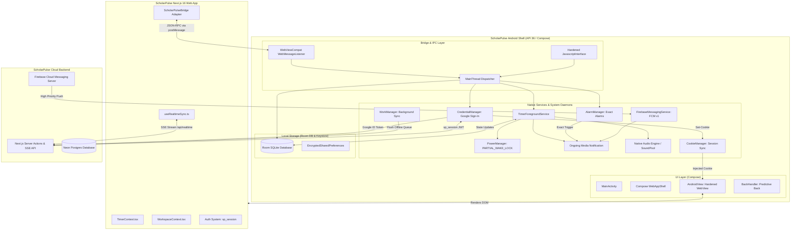
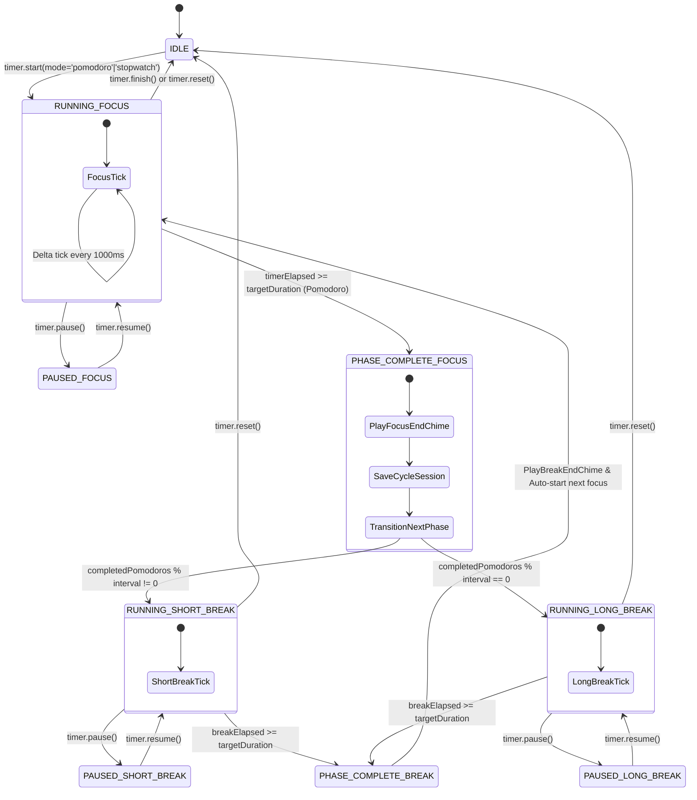
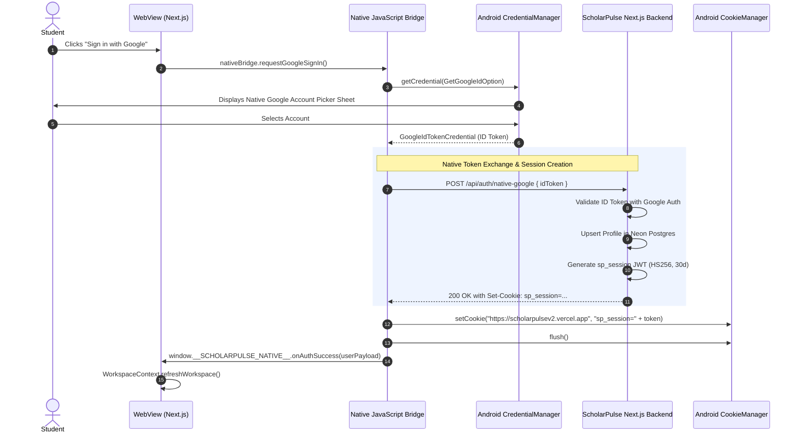
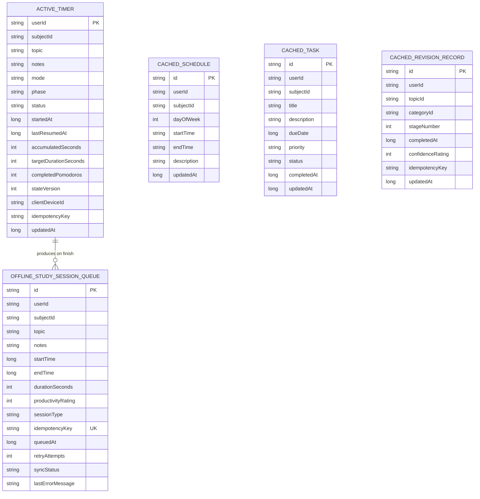

# ScholarPulse Android Native & Hybrid Shell Architecture Plan
**Target Platform:** Android 16 (API 36) • Modern Kotlin • Jetpack Compose • Material Design 3  
**Architecture Paradigm:** Hybrid Shell with Hardened Bidirectional JavaScript Bridge & Native Services  
**Author:** Senior Android Engineer  
**Date:** November 2026

---

## 1. Executive Summary & Codebase Audit Findings

A rigorous audit of the ScholarPulse `v2` codebase revealed severe platform limitations when running purely in mobile web browsers or as a standard Progressive Web App (PWA). The Android Native Shell is designed to eliminate these limitations while preserving the rapid iteration of the Next.js frontend.

### 1.1 Critical Vulnerabilities & Limitations in Web/PWA

| Subsystem | Web/PWA Implementation in `v2` | Mobile Failure Mode / OS Limitation | Android Native Shell Solution |
| :--- | :--- | :--- | :--- |
| **Study Timer** | `TimerContext.tsx` uses `setInterval(..., 1000)` and `computeElapsedSeconds()` based on `Date.now()`. | Android Chrome aggressively throttles or freezes background tabs after 30-60 seconds. When screen locks, JS execution halts; automatic Pomodoro phase switches and audio chimes fail until the user wakes the screen. | `TimerForegroundService` running with `PARTIAL_WAKE_LOCK`. Maintains high-precision tick loop, updates ongoing media-style notification with action buttons (`Pause`, `Resume`, `Stop`), and triggers audio alarms independently of webview state. |
| **Google Authentication** | `auth.ts` redirects to `accounts.google.com/o/oauth2/v2/auth`. | Google strictly blocks OAuth 2.0 requests originating from embedded WebViews with `403 disallowed_useragent` to protect against clickjacking. | Native `CredentialManager` API (`GetGoogleIdOption`) presenting standard Android bottom-sheet Google Sign-In. Handoff ID token to backend exchange endpoint and sync `sp_session` JWT directly via Android `CookieManager`. |
| **Notifications & Alarms** | `notifications.ts` runs in-memory `setInterval(..., 60000)` checking 8 PM streak protection and 10-minute class warnings. | The check dies completely when the browser tab is dismissed or backgrounded. Chrome Web Push is unvetted, lacks wake-locks, and fails Doze mode. | Dual system: `AlarmManager.setExactAndAllowWhileIdle()` for pinpoint class/streak alerts + FCM v1 (`FirebaseMessagingService`) for cloud pushes. Reschedules after reboot via `BootCompletedReceiver`. |
| **Audio Chimes** | `audio.ts` uses Web Audio API oscillators (`playTimerChime`). | Mobile browsers mandate user interaction before Web Audio can output sound. Browsers in background cannot play synthesized audio; Do Not Disturb is unmanaged. | Native `SoundPool` / `AudioTrack` audio engine playing exact synthesized frequencies (`focus_start`, `focus_end`, `break_end`, `achievement`) with `AudioFocusRequestCompat` ducking. |
| **Offline Persistence** | `TimerContext.tsx` stores unsaved sessions in `localStorage['sp_unsaved_study_sessions']`. | LocalStorage lacks schema integrity, is wiped under browser storage pressure, and cannot sync in background without the app actively open. | Persistent Room SQLite Database with `OfflineSessionQueueDao` and background `WorkManager` (`OfflineSyncWorker`) with exponential backoff and network constraints. |
| **UI Shell & Viewport** | Web layout uses standard CSS safe areas. | Viewport jumps, keyboard overlaps inputs, notch/cutout clipping, and lack of predictive back navigation support in Android 16. | Jetpack Compose shell with `enableEdgeToEdge()`, `WindowInsetsCompat` injection into WebView CSS properties (`--sat`, `--sab`), and Compose `BackHandler` bound to WebView history. |

---

## 2. Technical Requirements Document (TRD)

### 2.1 System Architecture Topology

The application follows an MVVM Clean Architecture with an isolated Native Service Core connected to the Jetpack Compose WebView shell via a hardened, origin-restricted JavaScript bridge.



---

### 2.2 Android 16 (API 36) Compliance & Platform Constraints

1. **Target SDK & Minimum SDK**:
   - `compileSdk = 36`
   - `targetSdk = 36` (Android 16 compliance for Google Play Store)
   - `minSdk = 26` (Android 8.0 Oreo; provides native Notification Channels, Background Service constraints, and `java.time`).
2. **16 KB Memory Page-Size Compatibility**:
   - Android 15/16 requires all bundled `.so` native libraries (such as SQLite NDK binaries or crypto engines) to be aligned to 16 KB boundaries.
   - Verified Gradle flag:
     ```kotlin
     android.packaging.jniLibs.useLegacyPackaging = false
     ```
3. **Mandatory Edge-to-Edge Layout**:
   - `enableEdgeToEdge()` is called in `MainActivity.onCreate()` before `setContent`.
   - Legacy system bar flags (`FLAG_LAYOUT_NO_LIMITS`, `SYSTEM_UI_FLAG_FULLSCREEN`) are deprecated/removed at API 36.
   - Status bar and navigation bar insets are handled via `WindowInsetsCompat.Type.systemBars()` and passed directly into the web application via CSS custom properties.
4. **Predictive Back Navigation**:
   - Legacy `onBackPressed()` is disabled.
   - Back handling is controlled via Jetpack Compose's `BackHandler(enabled = canGoBack)` which communicates with `webView.canGoBack()` and `webView.goBack()`.
5. **Large-Screen & Foldable Responsiveness**:
   - Support for Window Size Classes (`Compact`, `Medium`, `Expanded`).
   - On screens ≥ 600dp (foldables unfolded, tablets), the shell enforces dual-pane or fluid layout compatibility without orientation lock.

---

### 2.3 Foreground Service & Timer Subsystem

The ScholarPulse study timer is the heart of the platform. If the mobile operating system throttles or suspends the timer, the entire value proposition collapses.

#### 2.3.1 Service Declaration & Android 14/15/16 Compliance
Android 14+ requires explicit `foregroundServiceType` declarations in `AndroidManifest.xml` and corresponding runtime permissions.

```xml
<manifest xmlns:android="http://schemas.android.com/apk/res/android">
    <uses-permission android:name="android.permission.FOREGROUND_SERVICE" />
    <uses-permission android:name="android.permission.FOREGROUND_SERVICE_SPECIAL_USE" />
    <uses-permission android:name="android.permission.WAKE_LOCK" />
    <uses-permission android:name="android.permission.POST_NOTIFICATIONS" />

    <application>
        <service
            android:name=".services.TimerForegroundService"
            android:exported="false"
            android:foregroundServiceType="specialUse">
            <property
                android:name="android.app.PROPERTY_SPECIAL_USE_FGS_SUBTYPE"
                android:value="Academic study and Pomodoro focus tracking requiring precise interval timers, wake-lock maintenance, and ongoing interactive notification actions when the screen is locked." />
        </service>
    </application>
</manifest>
```

#### 2.3.2 Power Management & Partial WakeLock
- When the timer is transitioned to `'running'`, `TimerForegroundService` acquires a `PowerManager.WakeLock`:
  ```kotlin
  wakeLock = powerManager.newWakeLock(
      PowerManager.PARTIAL_WAKE_LOCK,
      "ScholarPulse::TimerWakeLock"
  ).apply {
      setReferenceCounted(false)
      acquire(4 * 60 * 60 * 1000L) // 4-hour safety timeout
  }
  ```
- When the timer is `'paused'`, `'stopped'`, or phase completed, the WakeLock is released immediately to conserve battery.

#### 2.3.3 High-Precision Timer State Machine
The native timer maintains millisecond precision by calculating delta timestamps rather than relying on delayed ticks:



#### 2.3.4 Ongoing Media Notification
- **Channel**: `scholarpulse_timer_channel`, Importance: `HIGH`, Category: `NotificationCompat.CATEGORY_STOPWATCH`.
- **Content**:
  - Title: Phase indicator (e.g., `Focus Session (25:00)` or `Short Break (05:00)`).
  - Text: Topic title + Subject name (e.g., `"Organic Chemistry Reaction Mechanisms • Chemistry"`).
  - Chronometer: Native Android `NotificationCompat.Builder.setChronometer` or live tick updates.
- **Action Buttons**:
  - When Running: `[ ⏸ Pause ]` and `[ ⏹ Finish ]`
  - When Paused: `[ ▶ Resume ]` and `[ ⏹ Discard ]`
  - When in Break: `[ ⏩ Skip Break ]` and `[ ⏹ Stop ]`
- Handled via `PendingIntent.getBroadcast()` directing to `TimerActionReceiver`, updating the native service and dispatching an IPC event back to the WebView JavaScript environment.

#### 2.3.5 Native Audio Chimes Engine
To replicate `v2/src/lib/audio.ts` without depending on Web Audio gestures:
- Uses an Android `SoundPool` initialized with `AudioAttributes.USAGE_NOTIFICATION_EVENT`.
- Pre-synthesizes the four ScholarPulse audio waveforms into lightweight PCM buffers:
  1. `focus_start`: C5 (523.25 Hz) → E5 (659.25 Hz), sine wave, 0.4s.
  2. `focus_end`: C5 (523.25 Hz) → E5 (659.25 Hz) → G5 (783.99 Hz) → C6 (1046.50 Hz), 0.6s.
  3. `break_end`: G5 (783.99 Hz) → E5 (659.25 Hz) → C5 (523.25 Hz), 0.5s.
  4. `achievement`: D5 (587.33 Hz) → F#5 (739.99 Hz) → A5 (880.00 Hz) → D6 (1174.66 Hz), 0.7s.
- Requests transient audio focus (`AUDIOFOCUS_GAIN_TRANSIENT_MAY_DUCK`) to momentarily duck Spotify/podcasts without cutting them off.

---

### 2.4 Native Google Sign-In & Cookie Synchronization

To completely eliminate Google's `403 disallowed_useragent` WebView block, authentication is handled natively via Android's `CredentialManager` API and synchronized with the Next.js server session.

#### 2.4.1 Architectural Authentication Flow



#### 2.4.2 CredentialManager Implementation Contract
```kotlin
val googleIdOption = GetGoogleIdOption.Builder()
    .setFilterByAuthorizedAccounts(false)
    .setServerClientId(context.getString(R.string.google_web_client_id))
    .setAutoSelectEnabled(false)
    .build()

val request = GetCredentialRequest.Builder()
    .addCredentialOption(googleIdOption)
    .build()

val credentialManager = CredentialManager.create(context)
val result = credentialManager.getCredential(context = activity, request = request)

when (val credential = result.credential) {
    is CustomCredential -> {
        if (credential.type == GoogleIdTokenCredential.TYPE_GOOGLE_ID_TOKEN_CREDENTIAL) {
            val googleIdTokenCredential = GoogleIdTokenCredential.createFrom(credential.data)
            val idToken = googleIdTokenCredential.idToken
            handleNativeGoogleAuthHandoff(idToken)
        }
    }
}
```

#### 2.4.3 Backend Authentication Endpoint Specification
- **Endpoint**: `POST /api/auth/native-google`
- **Headers**: `Content-Type: application/json`
- **Request Body**:
  ```json
  {
    "idToken": "eyJhbGciOiJSUzI1NiIs..."
  }
  ```
- **Response**:
  - `Set-Cookie: sp_session=<jwt_token>; Path=/; HttpOnly; Secure; SameSite=Lax; Max-Age=2592000`
  - Body:
    ```json
    {
      "success": true,
      "user": {
        "uid": "google_sub_12345",
        "email": "student@scholarpulse.edu",
        "name": "Tanvir Rahman",
        "avatarUrl": "https://lh3.googleusercontent.com/..."
      }
    }
    ```

---

### 2.5 Local Alarms & Cloud Push Subsystem

ScholarPulse requires two independent notification pipelines:
1. **Local Exact Alarms (`AlarmManager`)**: Works 100% offline without cellular data or Wi-Fi.
2. **Cloud Push Messaging (`FCM v1`)**: Cross-device sync, administrative announcements, and remote triggers.

#### 2.5.1 Exact Alarm Scheduling (`AlarmManager`)
- **Android 12+ (API 31+) Compliance**:
  - Requires `android.permission.SCHEDULE_EXACT_ALARM`.
  - Android shell validates `alarmManager.canScheduleExactAlarms()` before arming.
  - If false, displays Compose dialog guiding user to `Settings.ACTION_REQUEST_SCHEDULE_EXACT_ALARM`.
- **Scheduled Triggers**:
  1. **Timetable / Schedule Reminder**:
     - Calculates target timestamp: Class `startTime` minus 10 minutes (converted to device timezone).
     - Arms via `alarmManager.setExactAndAllowWhileIdle(RTC_WAKEUP, triggerTimeMs, pendingIntent)`.
     - Fires `ScheduleAlarmReceiver`: displays heads-up notification with subject color accent, class name, and `"Join Study"` deep link action.
  2. **Daily 8 PM Study Streak Protection**:
     - Calculates daily reminder time (`prefs.dailyReminderTime` or `20:00` in user timezone).
     - Query Room DB: if `todayLoggedSeconds < dailyStudyTargetSeconds`, arms exact alarm.
     - Fires `StreakProtectionReceiver`: warns student of streak loss risk before midnight.
- **Reboot Resilience**:
  - `BootCompletedReceiver` listens to `android.intent.action.BOOT_COMPLETED` and `android.intent.action.MY_PACKAGE_REPLACED`.
  - Automatically queries Room DB `ClassScheduleDao` and re-arms all upcoming weekly alarms.

#### 2.5.2 Firebase Cloud Messaging (`FCM v1`)
- **Service**: `AppFirebaseMessagingService extends FirebaseMessagingService`.
- **Token Lifecycle**:
  - `onNewToken(token)` sends token to backend via `POST /api/notifications/fcm-token` with the active `sp_session` cookie.
- **FCM Data Payload Schema**:
  ```json
  {
    "type": "timetable_alert" | "streak_protection" | "cloud_timer_sync" | "announcement",
    "title": "Upcoming Class: Higher Math II",
    "body": "Calculus integration lecture starts in 10 minutes.",
    "targetTab": "schedule",
    "targetId": "sch_sub_8831",
    "priority": "high"
  }
  ```
- **Cloud Timer Sync Handling**:
  - If another tab/device pauses or finishes the timer, FCM data message triggers native `TimerForegroundService.syncFromCloud(payload)` to keep Android notification in sync.

---

### 2.6 Room Database & Offline Queue

To replace fragile `localStorage.sp_unsaved_study_sessions`, the Android Native Shell implements a local SQLite database managed via Android Jetpack Room with Kotlin Coroutines and Flows.

#### 2.6.1 Room Database Schema (`ScholarPulseDatabase`)



#### 2.6.2 Entity Specifications (Kotlin)

```kotlin
@Entity(tableName = "active_timer")
data class ActiveTimerEntity(
    @PrimaryKey val userId: String,
    val subjectId: String,
    val topic: String,
    val notes: String?,
    val mode: String, // 'stopwatch' | 'pomodoro'
    val phase: String, // 'focus' | 'short_break' | 'long_break'
    val status: String, // 'running' | 'paused'
    val startedAt: Long,
    val lastResumedAt: Long,
    val accumulatedSeconds: Int,
    val targetDurationSeconds: Int,
    val completedPomodoros: Int,
    val stateVersion: Int,
    val clientDeviceId: String,
    val idempotencyKey: String,
    val updatedAt: Long = System.currentTimeMillis()
)

@Entity(
    tableName = "offline_study_sessions",
    indices = [Index(value = ["idempotencyKey"], unique = true)]
)
data class OfflineStudySessionEntity(
    @PrimaryKey val id: String = UUID.randomUUID().toString(),
    val userId: String,
    val subjectId: String,
    val topic: String,
    val notes: String?,
    val startTime: Long,
    val endTime: Long,
    val durationSeconds: Int,
    val productivityRating: Int = 5,
    val sessionType: String = "timer",
    val idempotencyKey: String,
    val queuedAt: Long = System.currentTimeMillis(),
    val retryAttempts: Int = 0,
    val syncStatus: String = "PENDING", // PENDING, SYNCING, FAILED
    val lastErrorMessage: String? = null
)

@Entity(tableName = "cached_schedules")
data class CachedScheduleEntity(
    @PrimaryKey val id: String,
    val userId: String,
    val subjectId: String,
    val dayOfWeek: Int, // 0 = Sunday ... 6 = Saturday
    val startTime: String, // "HH:mm"
    val endTime: String,
    val description: String?,
    val updatedAt: Long
)
```

#### 2.6.3 Offline Queue Synchronization (`OfflineSyncWorker`)
- Powered by Android `WorkManager`.
- Configured with `Constraints.Builder().setRequiredNetworkType(NetworkType.CONNECTED).build()`.
- **Execution Flow**:
  1. Queries all records from `offline_study_sessions` where `syncStatus != 'SUCCESS'`.
  2. Submits batch/individual requests to `POST /api/sessions/create` (or Server Action endpoint) using the stored `idempotencyKey`.
  3. If response is successful (or HTTP 409 conflict meaning already recorded), marks record as `SUCCESS` or deletes from queue.
  4. If server returns unrecoverable error (`400 Bad Request: subject does not exist`), flags record as `PERMANENT_ERROR` after 3 retries.
  5. Never swallows `CancellationException`.

---

## 3. BRIDGE_API.md Specification

The JavaScript Bridge forms the hardened, bidirectional communication pipeline between the Next.js web application and the Android Kotlin host.

### 3.1 Security Baseline & Bridge Configuration

1. **Origin Verification**:
   The native shell allows bridge interactions **strictly** from verified production and staging origins:
   - `https://scholarpulsev2.vercel.app`
   - `https://appassets.androidplatform.net` (for local offline fallback assets)
   - `http://localhost:3000` (strictly in `BuildConfig.DEBUG` mode)
2. **Dual-Channel Protocol**:
   - Primary: `WebViewCompat.addWebMessageListener` (modern origin-isolated channel; avoids global scope pollution).
   - Secondary Fallback: `@JavascriptInterface` object injected at `window.__ScholarPulseNativeBridge` with strict parameter sanitation.
3. **Threading Isolation**:
   Bridge calls execute on the `JavaBridge` background thread. The Android bridge dispatcher immediately offloads work using `Handler(Looper.getMainLooper()).post` or `serviceScope.launch(Dispatchers.IO)` before performing UI or database work.

---

### 3.2 Protocol Envelope (JSON-RPC 2.0 Styled)

#### Web to Native Request
```typescript
interface BridgeRequest<T = any> {
  id: string;          // UUID v4 for correlation
  method: string;      // Namespace.action (e.g. 'timer.start')
  params: T;           // Typed parameter payload
  timestamp: number;   // Epoch timestamp in milliseconds
}
```

#### Native to Web Response
```typescript
interface BridgeResponse<T = any> {
  id: string;          // Matching UUID v4
  success: boolean;
  result?: T;
  error?: {
    code: string;      // e.g. 'PERMISSION_DENIED', 'INVALID_PARAM'
    message: string;
  };
}
```

#### Native to Web Unsolicited Event
```typescript
interface NativeEvent<T = any> {
  event: string;       // e.g. 'timer.tick', 'auth.sessionExpired'
  payload: T;
  timestamp: number;
}
```

---

### 3.3 Complete Web to Native Methods

#### 1. `timer.start`
Starts a native Pomodoro or Stopwatch session in `TimerForegroundService`.
- **Parameters**:
  ```typescript
  interface TimerStartParams {
    subjectId: string;
    topic: string;
    notes?: string;
    mode: 'stopwatch' | 'pomodoro';
    targetDurationSeconds: number; // e.g. 1500 for 25m
    idempotencyKey: string;
  }
  ```
- **Returns**: `{ success: boolean, timer: ActiveTimerSession }`
- **Native Behavior**: Starts foreground service, acquires WakeLock, initializes notification, arms audio chimes.

#### 2. `timer.pause`
Pauses the active timer session.
- **Parameters**: `{}`
- **Returns**: `{ success: boolean, pausedAt: string, accumulatedSeconds: number }`
- **Native Behavior**: Stops tick countdown, releases WakeLock, updates notification actions to `[ Resume, Discard ]`.

#### 3. `timer.resume`
Resumes the paused timer session.
- **Parameters**: `{}`
- **Returns**: `{ success: boolean, resumedAt: string }`
- **Native Behavior**: Re-acquires WakeLock, resumes high-precision ticks, updates notification.

#### 4. `timer.stop`
Finishes the active study session and queues it for persistence.
- **Parameters**:
  ```typescript
  interface TimerStopParams {
    productivityRating?: number; // 1 to 5 (default 5)
    notes?: string;
    discard?: boolean;           // If true, discard without saving
  }
  ```
- **Returns**: `{ success: boolean, savedSessionId?: string, queuedLocally: boolean }`
- **Native Behavior**: Terminates foreground service, releases WakeLock, plays `focus_end` chime, writes completed session to Room DB `OfflineStudySessionEntity`, and triggers immediate `OfflineSyncWorker`.

#### 5. `timer.skipPhase`
Skips the current Pomodoro phase (e.g. skip break and enter focus immediately).
- **Parameters**: `{}`
- **Returns**: `{ success: boolean, newPhase: 'focus' | 'short_break' | 'long_break' }`

#### 6. `auth.googleSignIn`
Initiates native Android `CredentialManager` Google Sign-In sheet.
- **Parameters**: `{}`
- **Returns**:
  ```typescript
  interface AuthResult {
    success: boolean;
    user?: {
      uid: string;
      email: string;
      name: string;
      avatarUrl?: string;
    };
    error?: string;
  }
  ```
- **Native Behavior**: Launches Google bottom-sheet, exchanges ID token with `/api/auth/native-google`, sets session cookie in `CookieManager`, flushes to disk.

#### 7. `auth.syncSessionCookie`
Explicitly syncs a web session token into Android's native `CookieManager`.
- **Parameters**:
  ```typescript
  interface SyncCookieParams {
    token: string;
    domain: string; // e.g. "scholarpulsev2.vercel.app"
  }
  ```
- **Returns**: `{ success: boolean }`

#### 8. `notifications.requestPermission`
Requests runtime `POST_NOTIFICATIONS` (Android 13+) and exact alarm permissions.
- **Parameters**: `{}`
- **Returns**: `{ granted: boolean, exactAlarmsGranted: boolean }`

#### 9. `notifications.syncScheduleAlarms`
Replaces cached schedules in Room DB and arms exact class reminder alarms.
- **Parameters**:
  ```typescript
  interface SyncScheduleParams {
    schedules: Array<{
      id: string;
      subjectId: string;
      dayOfWeek: number;
      startTime: string; // "HH:mm"
      subjectName: string;
    }>;
    dailyReminderTime: string; // "20:00"
    dailyTargetMinutes: number;
  }
  ```
- **Returns**: `{ scheduledCount: number }`

#### 10. `audio.playChime`
Plays native synthesized sound chime.
- **Parameters**:
  ```typescript
  interface PlayChimeParams {
    type: 'focus_start' | 'focus_end' | 'break_end' | 'achievement';
  }
  ```
- **Returns**: `{ played: boolean }`

#### 11. `haptics.vibrate`
Provides tactile haptic feedback using Android's `Vibrator` / `VibratorManager`.
- **Parameters**:
  ```typescript
  interface HapticParams {
    style: 'light' | 'medium' | 'heavy' | 'success' | 'warning' | 'error';
  }
  ```
- **Returns**: `{ success: boolean }`

#### 12. `device.getInfo`
Returns native device metrics and feature availability.
- **Parameters**: `{}`
- **Returns**:
  ```typescript
  interface DeviceInfo {
    platform: 'android';
    osVersion: number;       // e.g. 36
    appVersion: string;     // e.g. "2.0.0"
    deviceId: string;       // Persistent hardware-backed device identifier
    fcmToken?: string;
    hasNotificationPermission: boolean;
    hasExactAlarmPermission: boolean;
    safeAreaInsets: {
      top: number;
      bottom: number;
      left: number;
      right: number;
    };
  }
  ```

#### 13. `navigation.openExternal`
Opens an external URL safely in Chrome Custom Tabs or external intent.
- **Parameters**: `{ url: string }`
- **Returns**: `{ opened: boolean }`

---

### 3.4 Complete Native to Web Events

The native shell delivers events to the web app by invoking:
```javascript
window.__SCHOLARPULSE_NATIVE_DISPATCHER__(JSON.stringify(eventPayload));
```

#### 1. `timer.tick`
Fired every second while the native foreground service is tracking time.
```json
{
  "event": "timer.tick",
  "payload": {
    "elapsedSeconds": 342,
    "remainingSeconds": 1158,
    "phase": "focus",
    "status": "running"
  },
  "timestamp": 1730700000000
}
```

#### 2. `timer.actionTriggered`
Fired when the student presses an action button on the Android Notification.
```json
{
  "event": "timer.actionTriggered",
  "payload": {
    "action": "pause" | "resume" | "stop" | "skip_break",
    "source": "notification_action"
  },
  "timestamp": 1730700000000
}
```

#### 3. `timer.phaseCompleted`
Fired when a Pomodoro phase elapses natively.
```json
{
  "event": "timer.phaseCompleted",
  "payload": {
    "completedPhase": "focus",
    "nextPhase": "short_break",
    "completedPomodoros": 1,
    "targetDurationSeconds": 300,
    "savedSession": {
      "subjectId": "sub_math_01",
      "durationSeconds": 1500
    }
  },
  "timestamp": 1730700000000
}
```

#### 4. `auth.sessionChanged`
Fired if Google Sign-In completes or native credentials expire.
```json
{
  "event": "auth.sessionChanged",
  "payload": {
    "authenticated": true,
    "user": {
      "uid": "google_sub_12345",
      "email": "student@scholarpulse.edu"
    }
  },
  "timestamp": 1730700000000
}
```

#### 5. `navigation.deepLink`
Fired when user clicks a push notification or timetable alert.
```json
{
  "event": "navigation.deepLink",
  "payload": {
    "tab": "schedule" | "revision" | "timer" | "analytics",
    "targetId": "sch_math_01"
  },
  "timestamp": 1730700000000
}
```

---

### 3.5 Client-Side TypeScript Bridge Hook (`useAndroidBridge.ts`)

```typescript
'use client';

import { useEffect, useRef, useState, useCallback } from 'react';

export interface AndroidBridge {
  isAvailable: boolean;
  invoke<T = any, R = any>(method: string, params?: T): Promise<R>;
  subscribe(event: string, callback: (payload: any) => void): () => void;
}

export function useAndroidBridge() {
  const [isAvailable, setIsAvailable] = useState<boolean>(false);
  const pendingRequests = useRef<Map<string, { resolve: Function; reject: Function }>>(new Map());
  const eventSubscribers = useRef<Map<string, Set<(payload: any) => void>>>(new Map());

  useEffect(() => {
    if (typeof window === 'undefined') return;

    const checkBridge = () => {
      const hasWebMessage = typeof (window as any).nativeBridge !== 'undefined';
      const hasInterface = typeof (window as any).__ScholarPulseNativeBridge !== 'undefined';
      setIsAvailable(hasWebMessage || hasInterface);
    };

    checkBridge();

    // Setup global dispatcher for native events and RPC responses
    (window as any).__SCHOLARPULSE_NATIVE_DISPATCHER__ = (rawPayload: string | object) => {
      try {
        const data = typeof rawPayload === 'string' ? JSON.parse(rawPayload) : rawPayload;

        // Check if this is a response to a pending request
        if (data.id && pendingRequests.current.has(data.id)) {
          const { resolve, reject } = pendingRequests.current.get(data.id)!;
          pendingRequests.current.delete(data.id);
          if (data.success) {
            resolve(data.result);
          } else {
            reject(new Error(data.error?.message || 'Bridge invocation failed'));
          }
          return;
        }

        // Check if this is an unsolicited native event
        if (data.event && eventSubscribers.current.has(data.event)) {
          eventSubscribers.current.get(data.event)!.forEach((cb) => cb(data.payload));
        }
      } catch (err) {
        console.error('Bridge message dispatch error:', err);
      }
    };

    return () => {
      delete (window as any).__SCHOLARPULSE_NATIVE_DISPATCHER__;
    };
  }, []);

  const invoke = useCallback(<T, R>(method: string, params: T = {} as T): Promise<R> => {
    return new Promise((resolve, reject) => {
      if (typeof window === 'undefined') {
        return reject(new Error('Window unavailable'));
      }

      const id = `req_${Date.now()}_${Math.random().toString(36).slice(2, 9)}`;
      const request = { id, method, params, timestamp: Date.now() };

      pendingRequests.current.set(id, { resolve, reject });

      // Timeout safety after 10s
      setTimeout(() => {
        if (pendingRequests.current.has(id)) {
          pendingRequests.current.delete(id);
          reject(new Error(`Bridge request timed out: ${method}`));
        }
      }, 10000);

      // Primary Channel: WebMessageListener
      if ((window as any).nativeBridge?.postMessage) {
        (window as any).nativeBridge.postMessage(JSON.stringify(request));
      }
      // Fallback Channel: JavascriptInterface
      else if ((window as any).__ScholarPulseNativeBridge?.postMessage) {
        (window as any).__ScholarPulseNativeBridge.postMessage(JSON.stringify(request));
      } else {
        pendingRequests.current.delete(id);
        reject(new Error('Native bridge not mounted'));
      }
    });
  }, []);

  const subscribe = useCallback((event: string, callback: (payload: any) => void) => {
    if (!eventSubscribers.current.has(event)) {
      eventSubscribers.current.set(event, new Set());
    }
    eventSubscribers.current.get(event)!.add(callback);

    return () => {
      eventSubscribers.current.get(event)?.delete(callback);
    };
  }, []);

  return { isAvailable, invoke, subscribe };
}
```

---

## 4. Target Project Scaffolding & Directory Blueprint

The Android project will reside in `/media/sanglap/Movies/scholarpulsev2/app` organized under modern Gradle multi-package Clean Architecture.

```text
/media/sanglap/Movies/scholarpulsev2/app/
├── build.gradle.kts                        # Root Gradle configuration
├── settings.gradle.kts                     # Module inclusion and plugin repositories
├── gradle/
│   ├── libs.versions.toml                  # Version Catalog (Kotlin 2.0+, Compose, Room, etc.)
│   └── wrapper/
│       ├── gradle-wrapper.jar
│       └── gradle-wrapper.properties       # Gradle 8.10+
├── app/
│   ├── build.gradle.kts                    # App-level build config (API 36, dependencies)
│   ├── proguard-rules.pro                  # Hardened R8 / Proguard rules for Room, Jose & JS Bridge
│   └── src/
│       └── main/
│           ├── AndroidManifest.xml         # Permissions, Service types, Receivers, Deep links
│           ├── res/
│               ├── drawable/               # Vector drawables (App logo, notification icons)
│               ├── mipmap-anydpi-v26/      # Adaptive icons
│               ├── raw/                    # Fallback audio assets
│               ├── values/                 # Colors, strings, themes
│               └── xml/                    # network_security_config.xml
│           ├── assets/
│               └── offline.html            # AssetLoader local fallback page
│           └── java/com/scholarpulse/app/
│               ├── ScholarPulseApp.kt      # Application class (Notification channels, WorkManager)
│               ├── MainActivity.kt         # Edge-to-edge Jetpack Compose host
│               ├── bridge/
│               │   ├── NativeBridgeDispatcher.kt  # JSON-RPC request router & main-thread hopping
│               │   ├── BridgeModels.kt            # Kotlinx Serializable request/response models
│               │   └── WebAppMessageListener.kt   # WebViewCompat WebMessageListener impl
│               ├── ui/
│               │   ├── WebAppShell.kt             # Compose AndroidView with safe-area insets
│               │   ├── SecureWebViewClient.kt     # Origin validation, AssetLoader, SSL check
│               │   ├── CustomWebChromeClient.kt   # File chooser, permission prompts
│               │   └── theme/
│               │       ├── Color.kt
│               │       ├── Theme.kt               # Material Design 3 tokens
│               │       └── Type.kt
│               ├── services/
│               │   ├── TimerForegroundService.kt  # WakeLock, live ticks, notification controller
│               │   ├── TimerActionReceiver.kt     # BroadcastReceiver for notification actions
│               │   └── AppFirebaseMessagingService.kt # FCM v1 push receiver
│               ├── auth/
│               │   ├── CredentialManagerHelper.kt # Native Google Sign-In sheet
│               │   └── SessionCookieSync.kt       # Webkit CookieManager synchronization
│               ├── alarms/
│               │   ├── ScheduleAlarmScheduler.kt  # AlarmManager exact scheduling
│               │   ├── ScheduleAlarmReceiver.kt   # Heads-up class notification launcher
│               │   ├── StreakProtectionReceiver.kt# 8 PM streak reminder launcher
│               │   └── BootCompletedReceiver.kt   # Reschedule on system boot
│               ├── audio/
│               │   └── NativeAudioEngine.kt       # SoundPool synthesized chimes & audio focus
│               ├── db/
│               │   ├── ScholarPulseDatabase.kt    # Room database declaration
│               │   ├── entities/                  # ActiveTimer, OfflineSession, Schedule entities
│               │   └── daos/                      # TimerDao, OfflineSessionDao, ScheduleDao
│               └── workers/
│                   ├── OfflineSyncWorker.kt       # WorkManager sync queue flusher
│                   └── DailyStreakWorker.kt       # Periodic streak health checker
```

---

## 5. Implementation Roadmap & Verification Plan

### Phase 1: Gradle Setup & Jetpack Compose Shell
1. Configure `build.gradle.kts` with `targetSdk = 36`, `minSdk = 26`, Kotlin 2.1, Compose BOM, and 16 KB page-size compatibility.
2. Build `MainActivity.kt` with `enableEdgeToEdge()` and window size class detection.
3. Embed `WebView` inside Compose `AndroidView`, configure `SecureWebViewClient` with HTTPS origin restriction (`scholarpulsev2.vercel.app`), SSL error cancellation, and `WebViewAssetLoader`.

### Phase 2: JavaScript Bridge & Authentication
1. Implement `NativeBridgeDispatcher.kt` using `WebViewCompat.addWebMessageListener` with main-thread dispatching.
2. Build `CredentialManagerHelper.kt` for native Google Sign-In.
3. Implement backend endpoint `POST /api/auth/native-google` in `v2` to verify ID tokens and issue `sp_session` JWTs.
4. Test native sign-in sheet, cookie synchronization, and verify zero `403 disallowed_useragent` errors.

### Phase 3: Timer Foreground Service & Audio
1. Implement `TimerForegroundService.kt` with `specialUse` foreground service type, `PARTIAL_WAKE_LOCK`, and ongoing interactive notification (`Pause`, `Resume`, `Stop`).
2. Implement `NativeAudioEngine.kt` to play the 4 synthesised chimes matching `v2/src/lib/audio.ts`.
3. Connect bidirectional bridge: Next.js `TimerContext` communicates with native service; notification actions trigger callbacks in Next.js.
4. Test: lock phone screen for 30 minutes; verify timer ticks without throttling, finishes accurately, and rings chime through lock screen.

### Phase 4: Room Database & Offline Sync Queue
1. Implement Room entities and DAOs for active timer, offline session queue, and timetable.
2. Implement `OfflineSyncWorker.kt` running under network constraints.
3. Update `TimerContext.tsx` to detect native bridge and route offline sessions through Room instead of `localStorage`.
4. Test: enable Airplane Mode, complete 35-minute study session, observe insertion in Room DB; disable Airplane Mode, verify WorkManager uploads session and updates streak.

### Phase 5: Push Notifications & Exact Alarms
1. Integrate `FirebaseMessagingService` for remote streak alerts and cloud timer synchronization.
2. Implement `AlarmManager.setExactAndAllowWhileIdle()` for 10-minute timetable class alarms and 8 PM streak protection.
3. Add `BootCompletedReceiver` to restore alarms upon device reboot.
4. Test: schedule class for 12 minutes in the future; verify Heads-Up Notification fires at the exact 10-minute mark while phone is in Doze mode.
