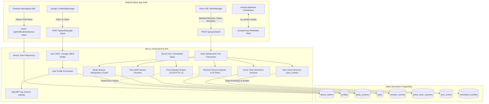
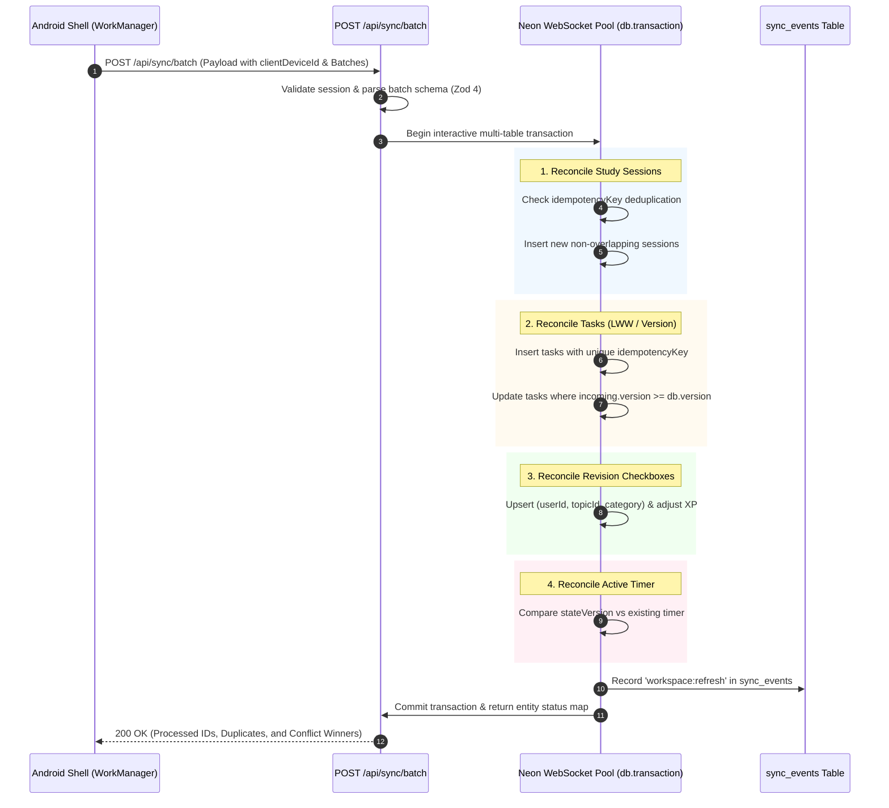

# ScholarPulse Native App Shell: Backend & Database Architecture Specification (TRD/PRD)

**Document Version:** 1.0.0  
**Target Environment:** Next.js 16 (App Router), React 19, Drizzle ORM 0.45.4, PostgreSQL (Neon Serverless via `@neondatabase/serverless`), Jose 6.2.14, Zod 4.6.7  
**Client Target:** Android Native App Shell (Jetpack Compose / WebView Hybrid, CredentialManager, FCM v1, WorkManager)  
**Author:** Senior Backend & Database Architect  
**Status:** Approved for Implementation  

---

## Table of Contents
1. [Executive Summary & Architecture Baseline](#1-executive-summary--architecture-baseline)
2. [Audit of Existing ScholarPulse v2 Foundation](#2-audit-of-existing-scholarpulse-v2-foundation)
3. [Database Schema Extensions (Drizzle ORM & SQL DDL)](#3-database-schema-extensions-drizzle-orm--sql-ddl)
4. [Native Google Sign-In Verification Architecture (`/api/auth/google-native`)](#4-native-google-sign-in-verification-architecture-apiauthgoogle-native)
5. [Idempotent Offline Sync Engine (`/api/sync/batch`)](#5-idempotent-offline-sync-engine-apisyncbatch)
6. [FCM Push Notification Dispatch Engine](#6-fcm-push-notification-dispatch-engine)
7. [Connection Management, Neon Serverless Pooling & Transactions](#7-connection-management-neon-serverless-pooling--transactions)
8. [Database Migration Plan & Non-Blocking Roll-Forward Policy](#8-database-migration-plan--non-blocking-roll-forward-policy)
9. [Comprehensive API Contracts & Error Envelope](#9-comprehensive-api-contracts--error-envelope)

---

## 1. Executive Summary & Architecture Baseline

ScholarPulse v2 provides an academic productivity workspace featuring Pomodoro/stopwatch study timers, weekly timetable schedules, task tracking, exam countdowns, gamification XP/achievements, and a syllabus revision tracker. 

To power the **ScholarPulse Native Android App Shell**, the backend architecture must extend beyond web-centric browser sessions and synchronous Server Actions. This document outlines the technical architecture to support:
1. **Native Google Sign-In**: Exchanging Android CredentialManager OIDC ID tokens for authoritative `sp_session` JWT cookies and bearer tokens.
2. **FCM Token Lifecycle Management**: Multi-device push notification token registration, rotation, and unregistration.
3. **Idempotent Offline Sync Engine**: A single atomic batch sync endpoint (`/api/sync/batch`) allowing Android's WorkManager queue to flush accumulated study sessions, task modifications, revision records, and timer updates without duplicate entries or race conditions.
4. **Push Notification Dispatch Engine**: Timezone-aware serverless triggers for 8:00 PM streak preservation warnings, 10-minute upcoming timetable class reminders, and cross-device timer phase completion alerts via Firebase Cloud Messaging (FCM v1).
5. **Drizzle ORM Schema Extensions**: Safe, zero-downtime, roll-forward migrations for Neon PostgreSQL.



---

## 2. Audit of Existing ScholarPulse v2 Foundation

### 2.1 Database Schema (23 Existing Tables)
The active PostgreSQL schema in `v2/src/lib/db/schema.ts` comprises 23 tables:
1. `profiles`: User core settings, daily target minutes, Pomodoro configurations, exam targets, gamification XP, ban status. Key: `userId` (text, unique).
2. `subjects`: User academic subjects with color, target minutes, and icons.
3. `study_sessions`: Historical study sessions. Key index: `(user_id, start_time)`. Has nullable `idempotency_key` unique column.
4. `active_timer_sessions`: Authoritative active running/paused timer. Unique on `userId`. Contains `idempotencyKey` and `stateVersion`.
5. `tasks`: To-do items. Lacks an explicit `idempotency_key` column (architectural gap addressed in Section 3).
6. `schedules`: Weekly recurring timetable slots (`day_of_week`, `start_time`, `end_time`).
7. `goals`: Daily/weekly/streak goals with target and current values.
8. `achievements`: Catalog of unlockable badges.
9. `user_achievements`: User unlocked badges (`user_id`, `achievement_id`).
10. `notification_preferences`: Web browser notification toggles, sound chimes, reminder times. Key: `userId`.
11. `curriculum_subjects`: Global syllabus subjects and user custom subjects.
12. `curriculum_papers`: Papers (1st paper, 2nd paper).
13. `curriculum_topics`: Topic and chapter hierarchy.
14. `user_curriculum_customizations`: Hidden/reordered curriculum nodes.
15. `revision_records`: Strict 6-category revision trackers. Unique on `(user_id, topic_id, category)`.
16. `curriculum_resources`: Bookmarked videos, drive links, and notes.
17. `sync_events`: Cross-device event log (`id: bigserial`, `user_id`, `event_type`, `payload`, `client_device_id`).
18. `admin_allowlist`: Authorized administrator email list.
19. `curriculum_stages`: Curriculum progression stages.
20. `goal_templates`: Predefined goal templates.
21. `schedule_templates`: Predefined schedule templates.
22. `system_configurations`: Key-value application configurations.

### 2.2 Auth Pipeline (`v2/src/lib/auth.ts`)
- **Session Mechanism**: Signed JWT stored in the `sp_session` cookie (`HS256`, 30-day lifetime, signed using `AUTH_SECRET`).
- **Current Flow**: Browser initiates GET `/api/auth/google`, redirects to Google with `oauth_state` cookie, callback at `/api/auth/google/callback` exchanges authorization code, provisions user in `profiles`, and writes `sp_session` cookie.
- **Limitation**: Android CredentialManager yields a Google ID token directly on device, bypassing browser redirects. An explicit ID-token verification endpoint is missing.

### 2.3 Realtime Event Streaming (`v2/src/app/api/realtime/route.ts`)
- Implements Server-Sent Events (SSE) with `clientDeviceId` filtering and `lastEventId` resumability.
- Features dual-tier delivery: in-process Node.js `EventEmitter` for sub-millisecond local instance dispatch, and Neon `sync_events` table polling (2s-4s adaptive backoff) for cross-instance coordination.
- Graceful connection termination at 55 seconds to prevent serverless timeout drops.

---

## 3. Database Schema Extensions (Drizzle ORM & SQL DDL)

To support mobile notifications, multi-device management, and offline task idempotency, two schema additions and two table enhancements are required.

### 3.1 New Table: `device_tokens`
Stores FCM registration tokens with hardware association, app version, and platform metadata.

```typescript
// v2/src/lib/db/schema.ts

export const deviceTokens = pgTable(
  'device_tokens',
  {
    id: uuid('id').defaultRandom().primaryKey(),
    userId: text('user_id')
      .notNull()
      .references(() => profiles.userId, { onDelete: 'cascade' }),
    fcmToken: text('fcm_token').notNull(),
    deviceId: text('device_id').notNull(), // Unique client hardware/app UUID
    platform: text('platform').notNull().default('android'), // 'android' | 'ios' | 'web'
    deviceModel: text('device_model').notNull().default(''), // e.g., 'Pixel 8', 'Samsung SM-S918B'
    appVersion: text('app_version').notNull().default(''),   // e.g., '2.1.0'
    isActive: boolean('is_active').notNull().default(true),
    lastUsedAt: timestamp('last_used_at', { withTimezone: true }).defaultNow().notNull(),
    createdAt: timestamp('created_at', { withTimezone: true }).defaultNow().notNull(),
    updatedAt: timestamp('updated_at', { withTimezone: true })
      .defaultNow()
      .notNull(),
  },
  (table) => [
    uniqueIndex('device_tokens_fcm_token_unique').on(table.fcmToken),
    uniqueIndex('device_tokens_user_device_unique').on(table.userId, table.deviceId),
    index('device_tokens_user_active_idx').on(table.userId, table.isActive),
    index('device_tokens_platform_active_idx').on(table.platform, table.isActive),
  ]
);

export type DeviceToken = typeof deviceTokens.$inferSelect;
export type NewDeviceToken = typeof deviceTokens.$inferInsert;
```

### 3.2 Enhanced Table: `tasks` (Adding `idempotency_key` and `version`)
Currently, `tasks` lacks an idempotency key. If an Android device generates tasks offline, network retries risk duplicate inserts. Furthermore, adding `version` allows deterministic Last-Write-Wins (LWW) conflict resolution during offline reconciliation.

```typescript
// Schema addition to tasks table in v2/src/lib/db/schema.ts
// Add columns:
// idempotencyKey: text('idempotency_key').unique(),
// version: integer('version').notNull().default(1),

export const tasks = pgTable(
  'tasks',
  {
    id: uuid('id').defaultRandom().primaryKey(),
    userId: text('user_id').notNull(),
    subjectId: uuid('subject_id')
      .notNull()
      .references(() => subjects.id, { onDelete: 'cascade' }),
    title: text('title').notNull(),
    description: text('description').default(''),
    dueDate: timestamp('due_date', { withTimezone: true }).notNull(),
    priority: text('priority').notNull().default('medium'),
    status: text('status').notNull().default('pending'),
    completedAt: timestamp('completed_at', { withTimezone: true }),
    idempotencyKey: text('idempotency_key').unique(),
    version: integer('version').notNull().default(1),
    createdAt: timestamp('created_at', { withTimezone: true }).defaultNow().notNull(),
    updatedAt: timestamp('updated_at', { withTimezone: true }).defaultNow().notNull(),
  },
  (table) => [
    index('tasks_user_id_idx').on(table.userId),
    index('tasks_subject_id_idx').on(table.subjectId),
    uniqueIndex('tasks_idempotency_key_idx').on(table.idempotencyKey),
  ]
);
```

### 3.3 Enhanced Table: `notification_preferences`
Add `pushNotificationsEnabled` to separate OS-level push notifications from browser notification permissions.

```typescript
// Schema addition to notificationPreferences in v2/src/lib/db/schema.ts
// pushNotificationsEnabled: boolean('push_notifications_enabled').notNull().default(true),
```

### 3.4 Raw Non-Blocking PostgreSQL DDL Migration
```sql
-- Migration: Add device_tokens table and task idempotency

-- 1. Create device_tokens table
CREATE TABLE IF NOT EXISTS "device_tokens" (
    "id" uuid PRIMARY KEY DEFAULT gen_random_uuid() NOT NULL,
    "user_id" text NOT NULL REFERENCES "profiles"("user_id") ON DELETE CASCADE,
    "fcm_token" text NOT NULL,
    "device_id" text NOT NULL,
    "platform" text DEFAULT 'android' NOT NULL,
    "device_model" text DEFAULT '' NOT NULL,
    "app_version" text DEFAULT '' NOT NULL,
    "is_active" boolean DEFAULT true NOT NULL,
    "last_used_at" timestamp with time zone DEFAULT now() NOT NULL,
    "created_at" timestamp with time zone DEFAULT now() NOT NULL,
    "updated_at" timestamp with time zone DEFAULT now() NOT NULL
);

-- 2. Create unique and composite indexes
CREATE UNIQUE INDEX IF NOT EXISTS "device_tokens_fcm_token_unique" ON "device_tokens" ("fcm_token");
CREATE UNIQUE INDEX IF NOT EXISTS "device_tokens_user_device_unique" ON "device_tokens" ("user_id", "device_id");
CREATE INDEX IF NOT EXISTS "device_tokens_user_active_idx" ON "device_tokens" ("user_id", "is_active");
CREATE INDEX IF NOT EXISTS "device_tokens_platform_active_idx" ON "device_tokens" ("platform", "is_active");

-- 3. Enhance tasks table with idempotency and optimistic versioning
ALTER TABLE "tasks" ADD COLUMN IF NOT EXISTS "idempotency_key" text;
ALTER TABLE "tasks" ADD COLUMN IF NOT EXISTS "version" integer DEFAULT 1 NOT NULL;
CREATE UNIQUE INDEX IF NOT EXISTS "tasks_idempotency_key_idx" ON "tasks" ("idempotency_key");

-- 4. Enhance notification_preferences table
ALTER TABLE "notification_preferences" ADD COLUMN IF NOT EXISTS "push_notifications_enabled" boolean DEFAULT true NOT NULL;
```

---

## 4. Native Google Sign-In Verification Architecture (`/api/auth/google-native`)

### 4.1 Verification Protocol
The Android native shell retrieves an OpenID Connect (OIDC) ID token via Google CredentialManager:
1. The client posts the token to `POST /api/auth/google-native`.
2. The server verifies the token signature against Google's public JSON Web Key Set (JWKS) using `jose.createRemoteJWKSet` (`https://www.googleapis.com/oauth2/v3/certs`).
3. Cryptographic assertions enforced:
   - Issuer (`iss`) must match `https://accounts.google.com` or `accounts.google.com`.
   - Audience (`aud`) must match `process.env.GOOGLE_CLIENT_ID` or `process.env.GOOGLE_ANDROID_CLIENT_ID`.
   - Expiration (`exp`) must be in the future.
4. If valid, the user's Google UID (`sub`), email, name, and picture are extracted.
5. `profiles` is queried; if absent, an initial student profile is seeded atomically.
6. The server generates a 30-day `sp_session` JWT using `jose.SignJWT`.
7. The endpoint sets the `sp_session` HTTP-only cookie on the `Set-Cookie` header and returns the user object and session token in the JSON body.

### 4.2 Endpoint Implementation Blueprint

```typescript
// v2/src/app/api/auth/google-native/route.ts
import { NextRequest, NextResponse } from 'next/server';
import { createRemoteJWKSet, jwtVerify, SignJWT } from 'jose';
import { z } from 'zod';
import { db } from '@/lib/db';
import { profiles, deviceTokens } from '@/lib/db/schema';
import { eq } from 'drizzle-orm';

const GoogleNativeAuthSchema = z.object({
  idToken: z.string().min(20, 'Invalid Google ID token format'),
  deviceId: z.string().min(1, 'Device ID is required'),
  deviceModel: z.string().optional().default(''),
  appVersion: z.string().optional().default(''),
  fcmToken: z.string().optional(),
});

const GOOGLE_JWKS = createRemoteJWKSet(new URL('https://www.googleapis.com/oauth2/v3/certs'), {
  cacheMaxAge: 24 * 60 * 60 * 1000, // 24 hours caching
  cooldownDuration: 30 * 1000,
});

export async function POST(req: NextRequest) {
  try {
    const rawBody = await req.json();
    const parsed = GoogleNativeAuthSchema.safeParse(rawBody);

    if (!parsed.success) {
      return NextResponse.json(
        {
          data: null,
          error: {
            code: 'VALIDATION_ERROR',
            message: 'Invalid request payload',
            details: parsed.error.flatten(),
          },
        },
        { status: 400 }
      );
    }

    const { idToken, deviceId, deviceModel, appVersion, fcmToken } = parsed.data;

    // Verify Google ID token cryptographically
    const allowedAudiences = [
      process.env.GOOGLE_CLIENT_ID,
      process.env.GOOGLE_ANDROID_CLIENT_ID,
    ].filter(Boolean) as string[];

    const { payload } = await jwtVerify(idToken, GOOGLE_JWKS, {
      issuer: ['https://accounts.google.com', 'accounts.google.com'],
      audience: allowedAudiences,
    });

    const sub = payload.sub;
    const email = payload.email as string;
    const name = (payload.name as string) || 'Scholar Student';
    const picture = (payload.picture as string) || '';

    if (!sub || !email) {
      return NextResponse.json(
        {
          data: null,
          error: { code: 'INVALID_CREDENTIALS', message: 'Token payload missing identity claims' },
        },
        { status: 401 }
      );
    }

    // Upsert or retrieve profile
    let profile = await db
      .select()
      .from(profiles)
      .where(eq(profiles.userId, sub))
      .limit(1)
      .then((res) => res[0]);

    if (!profile) {
      const [inserted] = await db
        .insert(profiles)
        .values({
          userId: sub,
          email,
          fullName: name,
          avatarUrl: picture,
          dailyStudyTargetMinutes: 360,
          preferredStudyTime: 'evening',
          timezone: 'Asia/Dhaka',
          themePreference: 'light',
          pomodoroFocusMinutes: 25,
          pomodoroShortBreakMinutes: 5,
          pomodoroLongBreakMinutes: 15,
          pomodoroLongBreakInterval: 4,
          onboardingCompleted: false,
          targetExamName: 'HSC 2027',
          targetExamDate: '2027-06-01',
        })
        .returning();
      profile = inserted;
    }

    if (profile.isBanned) {
      return NextResponse.json(
        {
          data: null,
          error: { code: 'ACCOUNT_BANNED', message: profile.bannedReason || 'Account is suspended' },
        },
        { status: 403 }
      );
    }

    // Optional FCM token association during login
    if (fcmToken) {
      await db
        .insert(deviceTokens)
        .values({
          userId: sub,
          fcmToken,
          deviceId,
          platform: 'android',
          deviceModel,
          appVersion,
          isActive: true,
          lastUsedAt: new Date(),
          updatedAt: new Date(),
        })
        .onConflictDoUpdate({
          target: [deviceTokens.userId, deviceTokens.deviceId],
          set: {
            fcmToken,
            deviceModel,
            appVersion,
            isActive: true,
            lastUsedAt: new Date(),
            updatedAt: new Date(),
          },
        });
    }

    // Sign native ScholarPulse session
    const AUTH_SECRET = process.env.AUTH_SECRET!;
    const secretKey = new TextEncoder().encode(AUTH_SECRET);
    const sessionToken = await new SignJWT({
      uid: sub,
      email,
      name,
      avatarUrl: picture,
      isBanned: false,
    })
      .setProtectedHeader({ alg: 'HS256' })
      .setIssuedAt()
      .setExpirationTime('30d')
      .sign(secretKey);

    const response = NextResponse.json({
      data: {
        sessionToken,
        user: {
          uid: sub,
          email,
          name,
          avatarUrl: picture,
          onboardingCompleted: profile.onboardingCompleted,
        },
      },
      error: null,
    });

    // Set HTTP-Only session cookie for WebView compatibility
    response.cookies.set('sp_session', sessionToken, {
      httpOnly: true,
      secure: process.env.NODE_ENV === 'production',
      sameSite: 'lax',
      path: '/',
      maxAge: 30 * 24 * 60 * 60, // 30 days
    });

    return response;
  } catch (err: unknown) {
    const error = err as Error;
    console.error('Native Google auth error:', error.message);
    return NextResponse.json(
      {
        data: null,
        error: { code: 'AUTH_VERIFICATION_FAILED', message: 'Failed to verify Google identity' },
      },
      { status: 401 }
    );
  }
}
```

---

## 5. Idempotent Offline Sync Engine (`/api/sync/batch`)

### 5.1 Architecture & Conflict Resolution Strategy
When an Android device reconnects to Wi-Fi/cellular, its local queue flushes buffered study sessions, tasks, revision checkboxes, and active timer changes in a single payload.

| Entity | Resolution Mechanism | Invariance / Idempotency Rule |
| :--- | :--- | :--- |
| **Study Sessions** | Unique `idempotencyKey` | If `idempotencyKey` already exists for this user, skip insert and return status `duplicate`. Calculate duration strictly via timestamps. |
| **Active Timer** | Monotonic `stateVersion` | If incoming `stateVersion > server.stateVersion`, overwrite server timer. If incoming `< server.stateVersion`, retain server timer and send server state back as conflict resolution. |
| **Tasks** | Client LWW + Versioning | For new tasks, deduplicate on `idempotencyKey`. For task status updates, compare `version` or update timestamp. Higher monotonic version commits. |
| **Revision Records** | Natural Unique Key Upsert | Keyed on `(userId, topicId, category)`. Upsert with `onConflictDoUpdate`. Recalculate XP delta dynamically. |



### 5.2 Batch Sync Schema Contract (`v2/src/lib/validations/sync.ts`)

```typescript
import { z } from 'zod';

export const StudySessionBatchItemSchema = z.object({
  clientSessionId: z.string().min(1),
  subjectId: z.string().uuid(),
  startTime: z.string().datetime(),
  endTime: z.string().datetime(),
  topic: z.string().min(1).max(200).default('General Study'),
  notes: z.string().max(2000).optional().default(''),
  productivityRating: z.number().int().min(1).max(5).default(4),
  sessionType: z.enum(['manual', 'timer']).default('manual'),
  idempotencyKey: z.string().min(10),
});

export const TaskBatchItemSchema = z.object({
  clientTaskId: z.string().min(1),
  id: z.string().uuid().optional(), // Provided if updating an existing task
  subjectId: z.string().uuid(),
  title: z.string().min(1).max(200),
  description: z.string().max(1000).optional().default(''),
  dueDate: z.string().datetime(),
  priority: z.enum(['low', 'medium', 'high']).default('medium'),
  status: z.enum(['pending', 'in_progress', 'completed']).default('pending'),
  completedAt: z.string().datetime().optional().nullable(),
  version: z.number().int().min(1).default(1),
  idempotencyKey: z.string().optional(),
});

export const RevisionBatchItemSchema = z.object({
  subjectId: z.string().uuid(),
  topicId: z.string().uuid(),
  category: z.enum([
    'class',
    'revision_note',
    'book_reading',
    'mcq_exam',
    'cq_solve',
    'test_paper_solving',
  ]),
  isCompleted: z.boolean(),
  activityDate: z.string().regex(/^\d{4}-\d{2}-\d{2}$/).optional(),
  notes: z.string().max(2000).optional().nullable(),
  clientUpdatedAt: z.string().datetime(),
});

export const ActiveTimerBatchItemSchema = z.object({
  subjectId: z.string().uuid(),
  topic: z.string().default('Focused Study'),
  notes: z.string().optional().default(''),
  mode: z.enum(['stopwatch', 'pomodoro']).default('stopwatch'),
  phase: z.enum(['focus', 'short_break', 'long_break']).default('focus'),
  status: z.enum(['running', 'paused']).default('running'),
  startedAt: z.string().datetime(),
  lastResumedAt: z.string().datetime(),
  accumulatedSeconds: z.number().int().min(0).default(0),
  targetDurationSeconds: z.number().int().min(0).default(1500),
  completedPomodoros: z.number().int().min(0).default(0),
  stateVersion: z.number().int().min(1),
  idempotencyKey: z.string().min(10),
});

export const BatchSyncRequestSchema = z.object({
  clientDeviceId: z.string().min(1),
  clientTimestamp: z.string().datetime(),
  studySessions: z.array(StudySessionBatchItemSchema).default([]),
  tasks: z.array(TaskBatchItemSchema).default([]),
  revisionRecords: z.array(RevisionBatchItemSchema).default([]),
  activeTimer: ActiveTimerBatchItemSchema.optional().nullable(),
});

export type BatchSyncRequest = z.infer<typeof BatchSyncRequestSchema>;
```

### 5.3 Batch Sync Endpoint (`/api/sync/batch/route.ts`)

```typescript
// v2/src/app/api/sync/batch/route.ts
import { NextRequest, NextResponse } from 'next/server';
import { getCurrentUser } from '@/lib/auth';
import { db } from '@/lib/db';
import {
  studySessions,
  tasks,
  revisionRecords,
  activeTimerSessions,
  profiles,
} from '@/lib/db/schema';
import { BatchSyncRequestSchema } from '@/lib/validations/sync';
import { publishSyncEvent } from '@/lib/realtime';
import { and, eq, inArray, sql } from 'drizzle-orm';

export async function POST(req: NextRequest) {
  const user = await getCurrentUser();
  if (!user || user.isBanned) {
    return NextResponse.json(
      {
        data: null,
        error: {
          code: user?.isBanned ? 'ACCOUNT_BANNED' : 'UNAUTHORIZED',
          message: 'Authentication required',
        },
      },
      { status: user?.isBanned ? 403 : 401 }
    );
  }

  const raw = await req.json();
  const parsed = BatchSyncRequestSchema.safeParse(raw);
  if (!parsed.success) {
    return NextResponse.json(
      {
        data: null,
        error: {
          code: 'VALIDATION_ERROR',
          message: 'Invalid batch sync structure',
          details: parsed.error.flatten(),
        },
      },
      { status: 400 }
    );
  }

  const { clientDeviceId, studySessions: sessionBatch, tasks: taskBatch, revisionRecords: revisionBatch, activeTimer: timerBatch } = parsed.data;

  // Execute interactive transaction over Neon WebSocket Pool
  const results = await db.transaction(async (tx) => {
    const sessionResults: { clientSessionId: string; status: 'synced' | 'duplicate' | 'rejected'; id?: string; error?: string }[] = [];
    const taskResults: { clientTaskId: string; status: 'created' | 'updated' | 'conflict_retained'; id?: string }[] = [];
    const revisionResults: { topicId: string; category: string; status: 'synced' }[] = [];
    let timerResult: { status: 'applied' | 'server_ahead' | 'skipped'; activeTimer?: unknown } = { status: 'skipped' };

    // 1. Process Study Sessions
    for (const item of sessionBatch) {
      const existing = await tx
        .select({ id: studySessions.id })
        .from(studySessions)
        .where(and(eq(studySessions.userId, user.uid), eq(studySessions.idempotencyKey, item.idempotencyKey)))
        .limit(1);

      if (existing.length > 0) {
        sessionResults.push({ clientSessionId: item.clientSessionId, status: 'duplicate', id: existing[0].id });
        continue;
      }

      const start = new Date(item.startTime);
      const end = new Date(item.endTime);
      const duration = Math.round((end.getTime() - start.getTime()) / 1000);

      if (duration <= 0 || duration > 86400) {
        sessionResults.push({
          clientSessionId: item.clientSessionId,
          status: 'rejected',
          error: 'Duration must be between 1 second and 24 hours',
        });
        continue;
      }

      const [inserted] = await tx
        .insert(studySessions)
        .values({
          userId: user.uid,
          subjectId: item.subjectId,
          startTime: start,
          endTime: end,
          durationSeconds: duration,
          topic: item.topic,
          notes: item.notes,
          productivityRating: item.productivityRating,
          sessionType: item.sessionType,
          idempotencyKey: item.idempotencyKey,
        })
        .returning({ id: studySessions.id });

      sessionResults.push({ clientSessionId: item.clientSessionId, status: 'synced', id: inserted.id });
    }

    // 2. Process Tasks
    for (const item of taskBatch) {
      if (item.id) {
        // Task update with optimistic concurrency
        const [existing] = await tx
          .select()
          .from(tasks)
          .where(and(eq(tasks.id, item.id), eq(tasks.userId, user.uid)))
          .limit(1);

        if (!existing || existing.version > item.version) {
          taskResults.push({ clientTaskId: item.clientTaskId, status: 'conflict_retained', id: item.id });
          continue;
        }

        await tx
          .update(tasks)
          .set({
            title: item.title,
            description: item.description,
            dueDate: new Date(item.dueDate),
            priority: item.priority,
            status: item.status,
            completedAt: item.completedAt ? new Date(item.completedAt) : null,
            version: item.version + 1,
            updatedAt: new Date(),
          })
          .where(eq(tasks.id, item.id));

        taskResults.push({ clientTaskId: item.clientTaskId, status: 'updated', id: item.id });
      } else {
        // New Task insert with idempotency
        if (item.idempotencyKey) {
          const [existing] = await tx
            .select({ id: tasks.id })
            .from(tasks)
            .where(eq(tasks.idempotencyKey, item.idempotencyKey))
            .limit(1);

          if (existing) {
            taskResults.push({ clientTaskId: item.clientTaskId, status: 'created', id: existing.id });
            continue;
          }
        }

        const [inserted] = await tx
          .insert(tasks)
          .values({
            userId: user.uid,
            subjectId: item.subjectId,
            title: item.title,
            description: item.description,
            dueDate: new Date(item.dueDate),
            priority: item.priority,
            status: item.status,
            completedAt: item.completedAt ? new Date(item.completedAt) : null,
            idempotencyKey: item.idempotencyKey,
            version: 1,
          })
          .returning({ id: tasks.id });

        taskResults.push({ clientTaskId: item.clientTaskId, status: 'created', id: inserted.id });
      }
    }

    // 3. Process Revision Records
    for (const item of revisionBatch) {
      const [existing] = await tx
        .select({ isCompleted: revisionRecords.isCompleted })
        .from(revisionRecords)
        .where(
          and(
            eq(revisionRecords.userId, user.uid),
            eq(revisionRecords.topicId, item.topicId),
            eq(revisionRecords.category, item.category)
          )
        )
        .limit(1);

      const wasCompleted = existing?.isCompleted ?? false;

      await tx
        .insert(revisionRecords)
        .values({
          userId: user.uid,
          subjectId: item.subjectId,
          topicId: item.topicId,
          category: item.category,
          isCompleted: item.isCompleted,
          activityDate: item.activityDate || new Date().toISOString().slice(0, 10),
          notes: item.notes || '',
          updatedAt: new Date(),
        })
        .onConflictDoUpdate({
          target: [revisionRecords.userId, revisionRecords.topicId, revisionRecords.category],
          set: {
            isCompleted: item.isCompleted,
            activityDate: item.activityDate || new Date().toISOString().slice(0, 10),
            notes: item.notes !== undefined ? item.notes : undefined,
            updatedAt: new Date(),
          },
        });

      // XP calculation: +25 if newly completed, -25 if unticked
      if (!wasCompleted && item.isCompleted) {
        await tx.update(profiles).set({ gamificationXp: sql`${profiles.gamificationXp} + 25` }).where(eq(profiles.userId, user.uid));
      } else if (wasCompleted && !item.isCompleted) {
        await tx.update(profiles).set({ gamificationXp: sql`GREATEST(0, ${profiles.gamificationXp} - 25)` }).where(eq(profiles.userId, user.uid));
      }

      revisionResults.push({ topicId: item.topicId, category: item.category, status: 'synced' });
    }

    // 4. Process Active Timer
    if (timerBatch) {
      const [currentServerTimer] = await tx
        .select()
        .from(activeTimerSessions)
        .where(eq(activeTimerSessions.userId, user.uid))
        .limit(1);

      if (currentServerTimer && currentServerTimer.stateVersion > timerBatch.stateVersion) {
        timerResult = { status: 'server_ahead', activeTimer: currentServerTimer };
      } else {
        const [applied] = await tx
          .insert(activeTimerSessions)
          .values({
            userId: user.uid,
            subjectId: timerBatch.subjectId,
            topic: timerBatch.topic,
            notes: timerBatch.notes,
            mode: timerBatch.mode,
            phase: timerBatch.phase,
            status: timerBatch.status,
            startedAt: new Date(timerBatch.startedAt),
            lastResumedAt: new Date(timerBatch.lastResumedAt),
            accumulatedSeconds: timerBatch.accumulatedSeconds,
            targetDurationSeconds: timerBatch.targetDurationSeconds,
            completedPomodoros: timerBatch.completedPomodoros,
            stateVersion: timerBatch.stateVersion,
            clientDeviceId,
            idempotencyKey: timerBatch.idempotencyKey,
            updatedAt: new Date(),
          })
          .onConflictDoUpdate({
            target: [activeTimerSessions.userId],
            set: {
              subjectId: timerBatch.subjectId,
              topic: timerBatch.topic,
              notes: timerBatch.notes,
              mode: timerBatch.mode,
              phase: timerBatch.phase,
              status: timerBatch.status,
              startedAt: new Date(timerBatch.startedAt),
              lastResumedAt: new Date(timerBatch.lastResumedAt),
              accumulatedSeconds: timerBatch.accumulatedSeconds,
              targetDurationSeconds: timerBatch.targetDurationSeconds,
              completedPomodoros: timerBatch.completedPomodoros,
              stateVersion: timerBatch.stateVersion,
              clientDeviceId,
              idempotencyKey: timerBatch.idempotencyKey,
              updatedAt: new Date(),
            },
          })
          .returning();

        timerResult = { status: 'applied', activeTimer: applied };
      }
    }

    return { sessionResults, taskResults, revisionResults, timerResult };
  });

  // Broadcast single consolidated refresh event to keep active web browser tabs updated
  await publishSyncEvent({
    userId: user.uid,
    eventType: 'workspace:refresh',
    payload: { source: 'batch_sync', timestamp: new Date().toISOString() },
    clientDeviceId,
  });

  return NextResponse.json({
    data: {
      ...results,
      syncedAt: new Date().toISOString(),
    },
    error: null,
  });
}
```

---

## 6. FCM Push Notification Dispatch Engine

### 6.1 Token Registration & Lifecycle API
Clients register and de-register tokens via `/api/notifications/device-token`:

```typescript
// v2/src/app/api/notifications/device-token/route.ts
import { NextRequest, NextResponse } from 'next/server';
import { getCurrentUser } from '@/lib/auth';
import { db } from '@/lib/db';
import { deviceTokens } from '@/lib/db/schema';
import { and, eq } from 'drizzle-orm';
import { z } from 'zod';

const DeviceTokenSchema = z.object({
  fcmToken: z.string().min(20),
  deviceId: z.string().min(1),
  platform: z.enum(['android', 'ios']).default('android'),
  deviceModel: z.string().optional().default(''),
  appVersion: z.string().optional().default(''),
});

export async function POST(req: NextRequest) {
  const user = await getCurrentUser();
  if (!user || user.isBanned) {
    return NextResponse.json({ data: null, error: { code: 'UNAUTHORIZED', message: 'Auth required' } }, { status: 401 });
  }

  const raw = await req.json();
  const parsed = DeviceTokenSchema.safeParse(raw);
  if (!parsed.success) {
    return NextResponse.json({ data: null, error: { code: 'VALIDATION_ERROR', message: 'Invalid payload' } }, { status: 400 });
  }

  const { fcmToken, deviceId, platform, deviceModel, appVersion } = parsed.data;

  // Deactivate any matching token previously registered to another user on the same hardware
  await db
    .update(deviceTokens)
    .set({ isActive: false })
    .where(and(eq(deviceTokens.fcmToken, fcmToken), eq(deviceTokens.isActive, true)));

  // Upsert token record for active user
  await db
    .insert(deviceTokens)
    .values({
      userId: user.uid,
      fcmToken,
      deviceId,
      platform,
      deviceModel,
      appVersion,
      isActive: true,
      lastUsedAt: new Date(),
      updatedAt: new Date(),
    })
    .onConflictDoUpdate({
      target: [deviceTokens.userId, deviceTokens.deviceId],
      set: {
        fcmToken,
        platform,
        deviceModel,
        appVersion,
        isActive: true,
        lastUsedAt: new Date(),
        updatedAt: new Date(),
      },
    });

  return NextResponse.json({ data: { registered: true }, error: null });
}

export async function DELETE(req: NextRequest) {
  const user = await getCurrentUser();
  if (!user) {
    return NextResponse.json({ data: null, error: { code: 'UNAUTHORIZED', message: 'Auth required' } }, { status: 401 });
  }

  const { searchParams } = new URL(req.url);
  const deviceId = searchParams.get('deviceId');

  if (deviceId) {
    await db
      .update(deviceTokens)
      .set({ isActive: false, updatedAt: new Date() })
      .where(and(eq(deviceTokens.userId, user.uid), eq(deviceTokens.deviceId, deviceId)));
  }

  return NextResponse.json({ data: { unregistered: true }, error: null });
}
```

### 6.2 FCM HTTP v1 Dispatch Module (`v2/src/lib/fcm.ts`)
Interacts with FCM v1 directly using Google Cloud Service Account authentication:

```typescript
// v2/src/lib/fcm.ts
import 'server-only';
import { SignJWT, importPKCS8 } from 'jose';
import { db } from './db';
import { deviceTokens } from './db/schema';
import { and, eq, inArray } from 'drizzle-orm';

interface FcmPayload {
  title: string;
  body: string;
  channelId: 'streak_alerts' | 'schedule_reminders' | 'timer_alerts';
  data?: Record<string, string>;
  priority?: 'normal' | 'high';
}

let cachedAccessToken: { token: string; expiresAt: number } | null = null;

async function getGoogleCloudAccessToken(): Promise<string> {
  if (cachedAccessToken && Date.now() < cachedAccessToken.expiresAt - 60000) {
    return cachedAccessToken.token;
  }

  const serviceAccountEmail = process.env.FIREBASE_CLIENT_EMAIL;
  const privateKeyRaw = process.env.FIREBASE_PRIVATE_KEY?.replace(/\\n/g, '\n');

  if (!serviceAccountEmail || !privateKeyRaw) {
    throw new Error('FCM credentials missing (FIREBASE_CLIENT_EMAIL or FIREBASE_PRIVATE_KEY)');
  }

  const privateKey = await importPKCS8(privateKeyRaw, 'RS256');
  const now = Math.floor(Date.now() / 1000);

  const jwt = await new SignJWT({
    iss: serviceAccountEmail,
    sub: serviceAccountEmail,
    aud: 'https://oauth2.googleapis.com/token',
    scope: 'https://www.googleapis.com/auth/firebase.messaging',
  })
    .setProtectedHeader({ alg: 'RS256' })
    .setIssuedAt(now)
    .setExpirationTime(now + 3600)
    .sign(privateKey);

  const res = await fetch('https://oauth2.googleapis.com/token', {
    method: 'POST',
    headers: { 'Content-Type': 'application/x-www-form-urlencoded' },
    body: new URLSearchParams({
      grant_type: 'urn:ietf:params:oauth:grant-type:jwt-bearer',
      assertion: jwt,
    }),
  });

  if (!res.ok) {
    throw new Error(`Failed to obtain Google OAuth access token: ${await res.text()}`);
  }

  const data = await res.json();
  cachedAccessToken = {
    token: data.access_token,
    expiresAt: Date.now() + data.expires_in * 1000,
  };

  return cachedAccessToken.token;
}

export async function sendFcmNotificationToUser(userId: string, payload: FcmPayload): Promise<{ sent: number; failed: number }> {
  const tokens = await db
    .select({ fcmToken: deviceTokens.fcmToken })
    .from(deviceTokens)
    .where(and(eq(deviceTokens.userId, userId), eq(deviceTokens.isActive, true)));

  if (tokens.length === 0) return { sent: 0, failed: 0 };

  const projectId = process.env.FIREBASE_PROJECT_ID;
  if (!projectId) throw new Error('FIREBASE_PROJECT_ID is not configured');

  const accessToken = await getGoogleCloudAccessToken();
  const endpoint = `https://fcm.googleapis.com/v1/projects/${projectId}/messages:send`;

  let sent = 0;
  let failed = 0;
  const invalidTokens: string[] = [];

  for (const { fcmToken } of tokens) {
    const fcmMessage = {
      message: {
        token: fcmToken,
        notification: {
          title: payload.title,
          body: payload.body,
        },
        android: {
          priority: payload.priority === 'high' ? 'high' : 'normal',
          notification: {
            channel_id: payload.channelId,
            icon: 'ic_notification',
            color: '#2563EB',
            sound: 'default',
          },
        },
        data: payload.data || {},
      },
    };

    try {
      const res = await fetch(endpoint, {
        method: 'POST',
        headers: {
          Authorization: `Bearer ${accessToken}`,
          'Content-Type': 'application/json',
        },
        body: JSON.stringify(fcmMessage),
      });

      if (res.ok) {
        sent++;
      } else {
        failed++;
        const errorBody = await res.json();
        const errorCode = errorBody?.error?.details?.[0]?.errorCode;
        if (errorCode === 'UNREGISTERED' || errorCode === 'INVALID_ARGUMENT') {
          invalidTokens.push(fcmToken);
        }
      }
    } catch {
      failed++;
    }
  }

  // Deactivate expired or invalidated tokens automatically
  if (invalidTokens.length > 0) {
    await db
      .update(deviceTokens)
      .set({ isActive: false, updatedAt: new Date() })
      .where(inArray(deviceTokens.fcmToken, invalidTokens));
  }

  return { sent, failed };
}
```

### 6.3 Automated Serverless Push Triggers

#### 1. 8:00 PM Daily Study Streak Danger Alert
- **Schedule**: Every 15 minutes (or top of the hour) via Vercel Cron.
- **Criteria**:
  - `notification_preferences.daily_reminder_enabled = true` and `push_notifications_enabled = true`.
  - User's current local time in their configured timezone (e.g., `'Asia/Dhaka'`) matches `dailyReminderTime` (default 20:00).
  - Recorded study minutes today < `profiles.dailyStudyTargetMinutes`.
- **Payload**:
  - `channelId`: `'streak_alerts'`
  - Title: `'🔥 Protect Your Daily Study Streak!'`
  - Body: `'You have studied {todayMinutes}m of your {targetMinutes}m goal. Complete a session before midnight to keep your streak!'`
  - Data: `{ type: 'streak_alert', targetMinutes: '360' }`

#### 2. 10-Minute Timetable Class Reminder
- **Schedule**: Every 5 minutes via Vercel Cron (`*/5 * * * *`).
- **Criteria**:
  - `notification_preferences.schedule_reminder_enabled = true` and `push_notifications_enabled = true`.
  - Current day of the week matches `schedules.day_of_week`.
  - Schedule start time is 8 to 12 minutes away in the user's local timezone.
- **Payload**:
  - `channelId`: `'schedule_reminders'`
  - Title: `'⏰ Upcoming Class: {subjectName}'`
  - Body: `'Starts in 10 minutes at {startTime}. Open your study notes.'`
  - Data: `{ type: 'schedule_reminder', scheduleId: '{id}' }`

#### 3. Cross-Device Timer Phase Transition Alert
- **Trigger**: Dispatched directly inside `completePomodoroPhaseAction` in `v2/src/actions/timer.ts`.
- **Action**: High-priority FCM dispatch to all active user device tokens (excluding the origin `clientDeviceId` if provided).
- **Payload**:
  - Priority: `'high'`
  - `channelId`: `'timer_alerts'`
  - Title: Focus Phase Complete (`'🔔 Focus Session Finished!'`) / Break Complete (`'☕ Break Complete — Refocus!'`).
  - Body: `'Completed Pomodoro #{n}. Take a 5-minute break.'`

---

## 7. Connection Management, Neon Serverless Pooling & Transactions

### 7.1 Driver & Transport Strategy
ScholarPulse v2 uses `@neondatabase/serverless` with the `ws` WebSocket driver instantiated in `v2/src/lib/db/index.ts`.
- **Connection String**: Neon `-pooler` connection string (`DATABASE_URL_POOLED` or `DATABASE_URL`).
- **Interactive Multi-Table Transactions**: Because multi-statement batch sync requires rollback protection across 4 tables, transactions must execute via the WebSocket pool (`Pool` driver). Neon's HTTP driver does not support interactive multi-statement `db.transaction()` callbacks.
- **Connection Exhaustion Prevention**:
  1. Transaction Timeout: Enforce 8,000ms maximum transaction duration on batch sync.
  2. Idle Timeout: Configure Pool with `idleTimeoutMillis: 10000`, `max: 10`.
  3. Re-use global pool across Next.js dev & warm serverless lambdas using `globalThis`.

```typescript
// Connection configuration in v2/src/lib/db/index.ts
import 'server-only';
import ws from 'ws';
import { Pool, neonConfig } from '@neondatabase/serverless';
import { drizzle } from 'drizzle-orm/neon-serverless';
import * as schema from './schema';

neonConfig.webSocketConstructor = ws;

const connectionString = process.env.DATABASE_URL_POOLED || process.env.DATABASE_URL;

if (!connectionString) {
  throw new Error('DATABASE_URL or DATABASE_URL_POOLED environment variable is not defined.');
}

const pool = new Pool({
  connectionString,
  max: 10,
  idleTimeoutMillis: 10000,
  connectionTimeoutMillis: 5000,
});

export const db = drizzle(pool, { schema });
```

---

## 8. Database Migration Plan & Non-Blocking Roll-Forward Policy

### 8.1 Roll-Forward Policy
1. **Never Execute Destructive DDL**: Never execute `DROP TABLE` or `DROP COLUMN` during deployment.
2. **Nullable Columns for Additions**: Add new columns as nullable or with explicit database defaults (`NOT NULL DEFAULT ...`) so existing queries continue running without failure.
3. **Safe Drizzle Migration Lifecycle**:
   - Step 1: Update Drizzle TypeScript schema in `v2/src/lib/db/schema.ts`.
   - Step 2: Generate timestamped migration via `pnpm drizzle-kit generate`.
   - Step 3: Inspect generated SQL for table locks and rewrite index creation if necessary.
   - Step 4: Apply migration against Neon direct branch (`DATABASE_URL_UNPOOLED`) before routing app traffic.

### 8.2 Execution Commands
```bash
# 1. Generate migration artifacts
pnpm drizzle-kit generate

# 2. Check generated migration file in v2/drizzle/
ls -la v2/drizzle/

# 3. Apply migration to Neon database
pnpm drizzle-kit migrate
```

---

## 9. Comprehensive API Contracts & Error Envelope

All RESTful endpoints strictly implement the standardized JSON envelope:

```typescript
export interface ApiResponse<T> {
  data: T | null;
  error: {
    code: string;
    message: string;
    details?: unknown;
  } | null;
}
```

### 9.1 Summary Catalog of New Endpoints

| Endpoint | Method | Purpose | Authentication |
| :--- | :--- | :--- | :--- |
| `/api/auth/google-native` | `POST` | Exchanges Google CredentialManager OIDC ID token for `sp_session` JWT | Public (Token verified against Google JWKS) |
| `/api/notifications/device-token` | `POST` | Registers or refreshes Android FCM registration token | Bearer Token / `sp_session` Cookie |
| `/api/notifications/device-token` | `DELETE` | Deactivates device token on user logout | Bearer Token / `sp_session` Cookie |
| `/api/sync/batch` | `POST` | Flushes queued study sessions, tasks, revisions, and timer idempotently | Bearer Token / `sp_session` Cookie |
| `/api/cron/notifications/streak` | `GET` | Evaluates users at 8 PM local time and dispatches streak warnings | Vercel Cron Secret / Admin Bearer |
| `/api/cron/notifications/schedules` | `GET` | Evaluates 10-minute upcoming timetable classes and dispatches alerts | Vercel Cron Secret / Admin Bearer |

### 9.2 Error Codes Catalogue

| Code | HTTP Status | Description | Action Required by Android Client |
| :--- | :--- | :--- | :--- |
| `VALIDATION_ERROR` | 400 | Payload fails Zod schema verification | Inspect `details` and fix request format |
| `INVALID_CREDENTIALS` | 401 | Google ID token expired or untrusted audience | Re-authenticate via CredentialManager |
| `UNAUTHORIZED` | 401 | Missing or invalid `sp_session` cookie / header | Redirect user to Login Screen |
| `ACCOUNT_BANNED` | 403 | User account has been administratively suspended | Display suspension notice with reason |
| `CONFLICT_RETAINED` | 200 / 409 | Server entity has higher monotonic version | Accept server entity state in response |
| `INTERNAL_SERVER_ERROR`| 500 | Database connection or unexpected runtime error | Retry with exponential backoff via WorkManager |

---
*End of Architectural Specification.*
