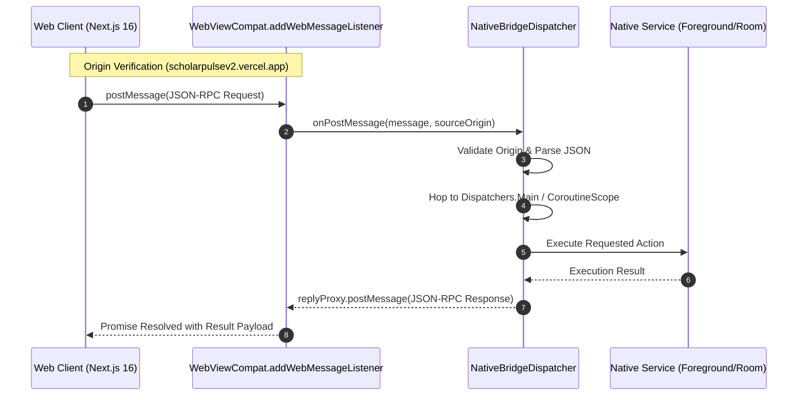

# ScholarPulse Android Native Bridge API Specification (`BRIDGE_API.md`)

**Document Version:** 1.0.0  
**Target Platform:** Android 16 (API Level 36) / Minimum SDK 26  
**Host Application:** ScholarPulse v2 (Next.js 16.4.3, React 19.3.0)  
**Contract Paradigm:** JSON-RPC 2.0 over `WebViewCompat.addWebMessageListener` with Fallback `@JavascriptInterface`  
**Status:** Approved Technical Specification  
**Author:** Lead Android Systems Architect & Security Specialist  

---

## 1. Architectural Baseline & Security Boundaries

The JavaScript Bridge establishes a secure, high-throughput, bidirectional IPC channel between the ScholarPulse Next.js web application and the Android Kotlin host.



### 1.1 Strict Origin Verification
Bridge calls are accepted **exclusively** from authorized origins:
```kotlin
val ALLOWED_ORIGINS = setOf(
    "https://scholarpulsev2.vercel.app",
    "https://appassets.androidplatform.net" // Local offline virtual domain
) + if (BuildConfig.DEBUG) setOf("http://localhost:3000", "http://10.0.2.2:3000") else emptySet()
```
If a message originates from any unauthorized origin or iframe, the bridge immediately rejects the call with error code `E_UNAUTHORIZED_ORIGIN`.

### 1.2 Dual-Channel Bridge Strategy
1. **Primary Channel (`WebViewCompat.addWebMessageListener`)**:
   - Modern, isolated, origin-scoped messaging. Injected as `window.nativeBridge`.
   - Prevents global scope pollution and blocks cross-origin iframe snooping.
2. **Secondary Fallback (`@JavascriptInterface`)**:
   - Mounted at `window.__ScholarPulseNativeBridge` with strict parameter sanitation for legacy web engine compatibility.
3. **Threading Isolation**:
   - Every incoming message arrives on Android's `JavaBridge` background thread. The native dispatcher immediately offloads execution using `Handler(Looper.getMainLooper()).post` for UI operations or `CoroutineScope(Dispatchers.IO).launch` for database and network transactions.

---

## 2. Protocol Envelopes (JSON-RPC 2.0 Compatible)

### 2.1 Web-to-Native Request Envelope
```typescript
interface BridgeRequest<T = any> {
  id: string;          // Cryptographically unique correlation ID (e.g. UUID v4)
  method: string;      // Namespace.action format (e.g. 'timer.start')
  params: T;           // Typed parameter payload object
  timestamp: number;   // Epoch timestamp in milliseconds
}
```

### 2.2 Native-to-Web Response Envelope
```typescript
interface BridgeResponse<T = any> {
  id: string;          // Matches the request ID
  success: boolean;    // Execution status flag
  result?: T;          // Typed return data on success
  error?: {
    code: BridgeErrorCode; // Standardized error identifier
    message: string;       // Human-readable diagnostic description
    details?: any;         // Optional debug metadata
  };
}
```

### 2.3 Native-to-Web Unsolicited Event Envelope
```typescript
interface NativeEvent<T = any> {
  event: string;       // Event identifier (e.g. 'timer.tick')
  payload: T;          // Structured event payload
  timestamp: number;   // Epoch timestamp in milliseconds
}
```

---

## 3. Web-to-Native Method Specifications

```
+---------------------------------------------------------------------------------+
|                               WEB TO NATIVE METHODS                             |
+---------------------------------------------------------------------------------+
| 1. timer.start             | Start native foreground timer with wake-lock       |
| 2. timer.pause             | Pause timer and release wake-lock                  |
| 3. timer.resume            | Resume high-precision timer loop                   |
| 4. timer.stop              | Terminate timer, queue study session in Room       |
| 5. timer.skipPhase         | Advance Pomodoro interval to next phase            |
| 6. auth.googleSignIn       | Launch native CredentialManager account sheet      |
| 7. auth.syncSessionCookie  | Flush JWT session directly to CookieManager        |
| 8. notif.requestPermission | Request POST_NOTIFICATIONS & exact alarms          |
| 9. notif.syncAlarms        | Cache timetable in Room and arm exact alarms       |
| 10. audio.playChime        | Emit native synthesized SoundPool audio chimes     |
| 11. haptics.vibrate        | Trigger tactile vibrator feedback patterns         |
| 12. device.getInfo         | Return device telemetry, OS version, and insets    |
| 13. navigation.openExternal| Open link in Chrome Custom Tabs                    |
+---------------------------------------------------------------------------------+
```

### 3.1 `timer.start`
Launches the native `TimerForegroundService`, acquires a `PARTIAL_WAKE_LOCK`, initializes the lock-screen notification, and starts the high-precision countdown.

- **Request Schema**:
  ```json
  {
    "type": "object",
    "properties": {
      "subjectId": { "type": "string" },
      "topic": { "type": "string" },
      "notes": { "type": "string" },
      "mode": { "type": "string", "enum": ["stopwatch", "pomodoro"] },
      "targetDurationSeconds": { "type": "integer", "minimum": 0 },
      "idempotencyKey": { "type": "string" }
    },
    "required": ["subjectId", "topic", "mode", "targetDurationSeconds", "idempotencyKey"]
  }
  ```
- **Response Schema**:
  ```json
  {
    "type": "object",
    "properties": {
      "started": { "type": "boolean" },
      "timer": {
        "type": "object",
        "properties": {
          "status": { "type": "string", "enum": ["running"] },
          "startedAt": { "type": "string", "format": "date-time" },
          "accumulatedSeconds": { "type": "integer" }
        }
      }
    },
    "required": ["started", "timer"]
  }
  ```
- **Error Codes**: `E_INVALID_PARAMS`, `E_SERVICE_UNAVAILABLE`.

---

### 3.2 `timer.pause`
Pauses the active timer, stops the countdown loop, releases the `PARTIAL_WAKE_LOCK`, and updates notification action buttons to `[ Resume, Discard ]`.

- **Request Parameters**: `{}` (empty object)
- **Response Schema**:
  ```json
  {
    "type": "object",
    "properties": {
      "paused": { "type": "boolean" },
      "accumulatedSeconds": { "type": "integer" },
      "pausedAt": { "type": "string", "format": "date-time" }
    },
    "required": ["paused", "accumulatedSeconds", "pausedAt"]
  }
  ```

---

### 3.3 `timer.resume`
Re-acquires the `PARTIAL_WAKE_LOCK`, resumes the millisecond-accurate countdown, and updates notification action buttons to `[ Pause, Finish ]`.

- **Request Parameters**: `{}` (empty object)
- **Response Schema**:
  ```json
  {
    "type": "object",
    "properties": {
      "resumed": { "type": "boolean" },
      "lastResumedAt": { "type": "string", "format": "date-time" }
    },
    "required": ["resumed", "lastResumedAt"]
  }
  ```

---

### 3.4 `timer.stop`
Terminates the foreground service, releases the WakeLock, dismisses the ongoing notification, plays the completion chime, writes the completed session into Room SQLite (`offline_study_sessions`), and triggers an immediate background `OfflineSyncWorker`.

- **Request Schema**:
  ```json
  {
    "type": "object",
    "properties": {
      "productivityRating": { "type": "integer", "minimum": 1, "maximum": 5 },
      "notes": { "type": "string" },
      "discard": { "type": "boolean" }
    }
  }
  ```
- **Response Schema**:
  ```json
  {
    "type": "object",
    "properties": {
      "stopped": { "type": "boolean" },
      "finalDurationSeconds": { "type": "integer" },
      "queuedOffline": { "type": "boolean" },
      "sessionId": { "type": "string" }
    },
    "required": ["stopped", "finalDurationSeconds", "queuedOffline"]
  }
  ```

---

### 3.5 `timer.skipPhase`
Advances the current Pomodoro interval to the next logical phase (e.g., skip from Short Break to next Focus interval).

- **Request Parameters**: `{}` (empty object)
- **Response Schema**:
  ```json
  {
    "type": "object",
    "properties": {
      "previousPhase": { "type": "string" },
      "newPhase": { "type": "string", "enum": ["focus", "short_break", "long_break"] },
      "targetDurationSeconds": { "type": "integer" }
    },
    "required": ["previousPhase", "newPhase", "targetDurationSeconds"]
  }
  ```

---

### 3.6 `auth.googleSignIn`
Triggers Android's native `CredentialManager` bottom-sheet account picker. Upon user selection, transmits the Google OIDC ID token to `/api/auth/google-native`, syncs the resulting `sp_session` cookie into native `CookieManager`, and flushes storage.

- **Request Parameters**: `{}` (empty object)
- **Response Schema**:
  ```json
  {
    "type": "object",
    "properties": {
      "authenticated": { "type": "boolean" },
      "user": {
        "type": "object",
        "properties": {
          "uid": { "type": "string" },
          "email": { "type": "string" },
          "name": { "type": "string" },
          "avatarUrl": { "type": "string" }
        },
        "required": ["uid", "email", "name"]
      }
    },
    "required": ["authenticated"]
  }
  ```
- **Error Codes**: `E_AUTH_CANCELLED`, `E_AUTH_FAILED`, `E_NETWORK_ERROR`.

---

### 3.7 `auth.syncSessionCookie`
Flushes a given session JWT directly into the native Android `CookieManager` store to keep native and web sessions in parity.

- **Request Schema**:
  ```json
  {
    "type": "object",
    "properties": {
      "token": { "type": "string" },
      "domain": { "type": "string" }
    },
    "required": ["token", "domain"]
  }
  ```
- **Response Schema**:
  ```json
  {
    "type": "object",
    "properties": {
      "synced": { "type": "boolean" }
    },
    "required": ["synced"]
  }
  ```

---

### 3.8 `notifications.requestPermission`
Prompts the user for runtime `POST_NOTIFICATIONS` (Android 13+) and checks `SCHEDULE_EXACT_ALARM` status.

- **Request Parameters**: `{}` (empty object)
- **Response Schema**:
  ```json
  {
    "type": "object",
    "properties": {
      "notificationsGranted": { "type": "boolean" },
      "exactAlarmsGranted": { "type": "boolean" }
    },
    "required": ["notificationsGranted", "exactAlarmsGranted"]
  }
  ```

---

### 3.9 `notifications.syncScheduleAlarms`
Updates cached timetable slots in Room SQLite (`cached_schedules`) and arms exact Android `AlarmManager` alarms (10 minutes prior to class start).

- **Request Schema**:
  ```json
  {
    "type": "object",
    "properties": {
      "schedules": {
        "type": "array",
        "items": {
          "type": "object",
          "properties": {
            "id": { "type": "string" },
            "subjectId": { "type": "string" },
            "subjectName": { "type": "string" },
            "dayOfWeek": { "type": "integer", "minimum": 0, "maximum": 6 },
            "startTime": { "type": "string", "pattern": "^[0-2][0-9]:[0-5][0-9]$" }
          },
          "required": ["id", "subjectId", "dayOfWeek", "startTime"]
        }
      },
      "dailyReminderTime": { "type": "string", "pattern": "^[0-2][0-9]:[0-5][0-9]$" },
      "dailyTargetMinutes": { "type": "integer", "minimum": 0 }
    },
    "required": ["schedules"]
  }
  ```
- **Response Schema**:
  ```json
  {
    "type": "object",
    "properties": {
      "armedAlarmCount": { "type": "integer" }
    },
    "required": ["armedAlarmCount"]
  }
  ```

---

### 3.10 `audio.playChime`
Synthesizes and emits native audio waveforms via `SoundPool` / `AudioTrack`, ducking background media with `AudioFocusRequestCompat`.

- **Request Schema**:
  ```json
  {
    "type": "object",
    "properties": {
      "type": {
        "type": "string",
        "enum": ["focus_start", "focus_end", "break_end", "achievement"]
      }
    },
    "required": ["type"]
  }
  ```
- **Response Schema**:
  ```json
  {
    "type": "object",
    "properties": {
      "played": { "type": "boolean" }
    },
    "required": ["played"]
  }
  ```

---

### 3.11 `haptics.vibrate`
Provides tactile haptic feedback using Android's `Vibrator` / `VibratorManager`.

- **Request Schema**:
  ```json
  {
    "type": "object",
    "properties": {
      "style": {
        "type": "string",
        "enum": ["light", "medium", "heavy", "success", "warning", "error"]
      }
    },
    "required": ["style"]
  }
  ```
- **Response Schema**:
  ```json
  {
    "type": "object",
    "properties": {
      "success": { "type": "boolean" }
    },
    "required": ["success"]
  }
  ```

---

### 3.12 `device.getInfo`
Returns native device metrics, platform capabilities, and dynamic safe-area insets.

- **Request Parameters**: `{}` (empty object)
- **Response Schema**:
  ```json
  {
    "type": "object",
    "properties": {
      "platform": { "type": "string", "enum": ["android"] },
      "osVersion": { "type": "integer" },
      "appVersion": { "type": "string" },
      "deviceId": { "type": "string" },
      "fcmToken": { "type": "string" },
      "hasNotificationPermission": { "type": "boolean" },
      "hasExactAlarmPermission": { "type": "boolean" },
      "safeAreaInsets": {
        "type": "object",
        "properties": {
          "top": { "type": "integer" },
          "bottom": { "type": "integer" },
          "left": { "type": "integer" },
          "right": { "type": "integer" }
        },
        "required": ["top", "bottom", "left", "right"]
      }
    },
    "required": ["platform", "osVersion", "appVersion", "deviceId", "safeAreaInsets"]
  }
  ```

---

### 3.13 `navigation.openExternal`
Safely opens external syllabus references, YouTube lectures, or Drive links inside Chrome Custom Tabs.

- **Request Schema**:
  ```json
  {
    "type": "object",
    "properties": {
      "url": { "type": "string", "format": "uri" }
    },
    "required": ["url"]
  }
  ```
- **Response Schema**:
  ```json
  {
    "type": "object",
    "properties": {
      "opened": { "type": "boolean" }
    },
    "required": ["opened"]
  }
  ```

---

## 4. Native-to-Web Unsolicited Event Specifications

Events pushed spontaneously from native Android services to the web application:

```javascript
window.__SCHOLARPULSE_NATIVE_DISPATCHER__(JSON.stringify(eventPayload));
```

### 4.1 `timer.tick`
Fired every 1000ms by `TimerForegroundService` while the timer is running.
```json
{
  "event": "timer.tick",
  "payload": {
    "elapsedSeconds": 342,
    "remainingSeconds": 1158,
    "phase": "focus",
    "status": "running"
  },
  "timestamp": 1730700000000
}
```

### 4.2 `timer.actionTriggered`
Fired when the student taps an action button on the lock-screen ongoing notification.
```json
{
  "event": "timer.actionTriggered",
  "payload": {
    "action": "pause",
    "source": "notification_action"
  },
  "timestamp": 1730700000000
}
```

### 4.3 `timer.phaseCompleted`
Fired when a Pomodoro interval elapses natively.
```json
{
  "event": "timer.phaseCompleted",
  "payload": {
    "completedPhase": "focus",
    "nextPhase": "short_break",
    "completedPomodoros": 1,
    "targetDurationSeconds": 300,
    "savedSession": {
      "subjectId": "sub_math_01",
      "durationSeconds": 1500,
      "idempotencyKey": "timer_1730700000000_pomo_1"
    }
  },
  "timestamp": 1730700000000
}
```

### 4.4 `auth.sessionChanged`
Fired when native Google authentication succeeds or credentials expire.
```json
{
  "event": "auth.sessionChanged",
  "payload": {
    "authenticated": true,
    "user": {
      "uid": "104829104928104",
      "email": "student@scholarpulse.edu",
      "name": "Tanvir Rahman"
    }
  },
  "timestamp": 1730700000000
}
```

### 4.5 `navigation.deepLink`
Fired when the student opens an exact timetable alert or push notification.
```json
{
  "event": "navigation.deepLink",
  "payload": {
    "tab": "schedule",
    "targetId": "sch_sub_8831"
  },
  "timestamp": 1730700000000
}
```

---

## 5. Standardized Error Codes & Diagnostics

| Error Code | HTTP Equivalent | Description & Recovery Guidance |
| :--- | :--- | :--- |
| `E_UNAUTHORIZED_ORIGIN`| 403 Forbidden | Request originated from an unapproved web origin. Blocked immediately. |
| `E_INVALID_PARAMS` | 400 Bad Request | Payload failed Zod/Kotlinx serialization schema validation. |
| `E_PERMISSION_DENIED` | 403 Forbidden | User rejected `POST_NOTIFICATIONS` or exact alarm scheduling. |
| `E_AUTH_CANCELLED` | 499 Cancelled | User dismissed native CredentialManager account sheet without selecting. |
| `E_AUTH_FAILED` | 401 Unauthorized | Backend failed to verify Google OIDC token or issue session cookie. |
| `E_SERVICE_UNAVAILABLE`| 503 Unavailable | Native service could not start (e.g. background execution restriction). |
| `E_TIMEOUT` | 504 Gateway Timeout | Bridge call exceeded the 10,000ms synchronous response ceiling. |
| `E_INTERNAL_ERROR` | 500 Server Error | Unhandled Kotlin runtime exception. Details logged to Crashlytics. |

---

## 6. Client-Side TypeScript Adapter (`useAndroidBridge.ts`)

```typescript
'use client';

import { useEffect, useRef, useState, useCallback } from 'react';

export interface BridgeRequest<T = any> {
  id: string;
  method: string;
  params: T;
  timestamp: number;
}

export interface BridgeResponse<T = any> {
  id: string;
  success: boolean;
  result?: T;
  error?: {
    code: string;
    message: string;
    details?: any;
  };
}

export function useAndroidBridge() {
  const [isAvailable, setIsAvailable] = useState<boolean>(false);
  const pendingRequests = useRef<Map<string, { resolve: (res: any) => void; reject: (err: any) => void }>>(new Map());
  const eventSubscribers = useRef<Map<string, Set<(payload: any) => void>>>(new Map());

  useEffect(() => {
    if (typeof window === 'undefined') return;

    const checkBridge = () => {
      const hasWebMessage = typeof (window as any).nativeBridge !== 'undefined';
      const hasInterface = typeof (window as any).__ScholarPulseNativeBridge !== 'undefined';
      setIsAvailable(hasWebMessage || hasInterface);
    };

    checkBridge();

    // Global dispatcher for native responses and unsolicited events
    (window as any).__SCHOLARPULSE_NATIVE_DISPATCHER__ = (rawPayload: string | object) => {
      try {
        const data: any = typeof rawPayload === 'string' ? JSON.parse(rawPayload) : rawPayload;

        // Route correlation response
        if (data.id && pendingRequests.current.has(data.id)) {
          const { resolve, reject } = pendingRequests.current.get(data.id)!;
          pendingRequests.current.delete(data.id);
          if (data.success) {
            resolve(data.result);
          } else {
            reject(new Error(data.error?.message || `Bridge Error: ${data.error?.code}`));
          }
          return;
        }

        // Route unsolicited event
        if (data.event && eventSubscribers.current.has(data.event)) {
          eventSubscribers.current.get(data.event)!.forEach((cb) => cb(data.payload));
        }
      } catch (err) {
        console.error('[ScholarPulse Bridge] Dispatcher Error:', err);
      }
    };

    return () => {
      delete (window as any).__SCHOLARPULSE_NATIVE_DISPATCHER__;
    };
  }, []);

  const invoke = useCallback(<T, R>(method: string, params: T = {} as T): Promise<R> => {
    return new Promise((resolve, reject) => {
      if (typeof window === 'undefined') {
        return reject(new Error('Window context unavailable'));
      }

      const id = `req_${Date.now()}_${Math.random().toString(36).slice(2, 9)}`;
      const request: BridgeRequest<T> = { id, method, params, timestamp: Date.now() };

      pendingRequests.current.set(id, { resolve, reject });

      // 10-second timeout ceiling
      const timeout = setTimeout(() => {
        if (pendingRequests.current.has(id)) {
          pendingRequests.current.delete(id);
          reject(new Error(`Bridge request timed out: ${method}`));
        }
      }, 10000);

      // Wrap resolve/reject to clear timeout
      const origResolve = resolve;
      const origReject = reject;
      pendingRequests.current.set(id, {
        resolve: (val) => { clearTimeout(timeout); origResolve(val); },
        reject: (err) => { clearTimeout(timeout); origReject(err); },
      });

      // Primary Channel: WebMessageListener
      if ((window as any).nativeBridge?.postMessage) {
        (window as any).nativeBridge.postMessage(JSON.stringify(request));
      }
      // Fallback Channel: JavascriptInterface
      else if ((window as any).__ScholarPulseNativeBridge?.postMessage) {
        (window as any).__ScholarPulseNativeBridge.postMessage(JSON.stringify(request));
      } else {
        clearTimeout(timeout);
        pendingRequests.current.delete(id);
        reject(new Error('Native Android bridge not available'));
      }
    });
  }, []);

  const subscribe = useCallback((event: string, callback: (payload: any) => void) => {
    if (!eventSubscribers.current.has(event)) {
      eventSubscribers.current.set(event, new Set());
    }
    eventSubscribers.current.get(event)!.add(callback);

    return () => {
      eventSubscribers.current.get(event)?.delete(callback);
    };
  }, []);

  return { isAvailable, invoke, subscribe };
}
```
