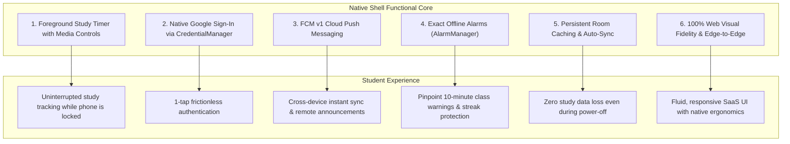

# ScholarPulse Android Native & Hybrid Shell — Product Requirements Document (PRD)

**Document Version:** 1.0.0  
**Target Platform:** Android 16 (API Level 36) / Minimum SDK 26 (Android 8.0 Oreo)  
**Host Application:** ScholarPulse v2 (Next.js 16.4.3, React 19.3.0, Tailwind CSS v4, Neon Serverless PostgreSQL)  
**Target App Directory:** `/media/sanglap/Movies/scholarpulsev2/app`  
**Status:** Approved Architectural Blueprint  
**Author:** Lead Android Systems Engineer & Product Architecture Specialist  

---

## 1. Executive Summary & Problem Statement

ScholarPulse is a dedicated academic productivity workspace designed for competitive exam candidates. It provides Pomodoro and stopwatch study interval tracking, timetable class schedules, task deadline tracking, curriculum syllabus revision matrices, and gamified XP/streak milestones.

While ScholarPulse v2 delivers a world-class desktop web experience, testing on mobile devices demonstrates that a pure Progressive Web App (PWA) or mobile browser deployment fails catastrophically in production due to fundamental mobile operating system constraints.

```
+-----------------------------------------------------------------------------------+
|                           CRITICAL PWA FAILURE MODES                              |
+-----------------------------------------------------------------------------------+
| 1. Timer Sleep Throttling   | Chrome suspends background JS threads after 30-60s.  |
|                             | Screen lock halts study tracking; chimes fail.       |
| 2. Google OAuth 403 Block   | Google blocks WebView OAuth: '403 disallowed_agent'. |
|                             | Students cannot authenticate with Google accounts.  |
| 3. Notification Mortality   | In-memory setInterval dies on tab dismissal.         |
|                             | Students miss 8 PM streak alerts & class reminders. |
| 4. Data Loss Under Pressure | LocalStorage is evicted under phone memory pressure. |
|                             | Offline study sessions are lost permanently.         |
+-----------------------------------------------------------------------------------+
```

### 1.1 The Four Core Mobile Bottlenecks

1. **Timer Sleep Throttling & Process Suspension**:
   - In `v2/src/context/TimerContext.tsx`, timer progression relies on browser `setInterval(..., 1000)` and `Date.now()`.
   - Modern Android OEM battery management (Samsung OneUI, Xiaomi HyperOS, Google Pixel Adaptive Battery) throttles background browser timers to once per minute or freezes execution entirely when the device screen locks.
   - **User Impact**: A student sets a 25-minute Pomodoro, puts their phone face-down to study, and the interval never transitions to break. Audio chimes fail to sound, study hours are miscalculated, and the core utility of the app is destroyed.

2. **Google OAuth 403 `disallowed_useragent` Rejection**:
   - Google strictly forbids OAuth 2.0 authorization requests within embedded WebViews to defend against credential harvesting and clickjacking.
   - Navigating to `https://accounts.google.com/o/oauth2/v2/auth` inside an Android WebView results in a dead-end error screen: `403: disallowed_useragent`.
   - **User Impact**: 100% sign-in failure for users with Google-linked accounts.

3. **Background Push Notification Mortality**:
   - `v2/src/lib/notifications.ts` schedules class alarms and 8:00 PM streak preservation reminders using an in-memory client `setInterval` loop.
   - When the user switches apps or clears the browser from recents, the JavaScript runtime is terminated. Furthermore, Web Push via service workers cannot wake locked Android devices reliably or punch through Doze mode without native system integration.
   - **User Impact**: Students miss critical lectures and break hard-earned study streaks.

4. **Offline Data Vulnerability & Storage Volatility**:
   - Unsaved study sessions in `v2` are buffered in `localStorage['sp_unsaved_study_sessions']`.
   - `localStorage` is not transactional, has a strict 5MB quota, is subject to silent deletion during low-storage cleanups, and cannot flush in the background when the app is closed.
   - **User Impact**: Students studying in low-connectivity areas (e.g. during bus commutes, rural coaching centers) lose hours of verified study data.

---

## 2. Product Vision & Target Audience

### 2.1 Vision
To deliver an uncompromising, distraction-free Android native study shell that wraps the responsive ScholarPulse web application into an unbreakable native container. The native shell operates as an invisible, high-performance frame—empowering students to track multi-hour study sessions with reliable lock-screen notifications, exact alarms, instant Google authentication, and zero data loss.

### 2.2 Target Audience
- **Competitive Exam Candidates**: HSC (Higher Secondary Certificate) and SSC students in Bangladesh, university admission seekers (BUET, Medical College, DU/IUT Engineering entrance), and standardized test takers.
- **Study Habits**: High-intensity study blocks (6–12 hours daily), rigorous revision schedules across complex science curricula (Physics, Chemistry, Higher Mathematics, Biology), and constant mobile usage while studying at desks, libraries, or coaching centers.
- **Device Ecosystem**: Diverse Android device spectrum ranging from budget devices (e.g., Samsung Galaxy A03, Xiaomi Redmi with 3GB–4GB RAM, Android 8.0–11) to flagship hardware (Pixel 8/9, Galaxy S24, foldables with Android 14–16).

---

## 3. Core Functional Requirements



### 3.1 Feature 1: Foreground Study Timer & Lock-Screen Media Controls
- **FR-1.1 High-Precision Background Tracking**: The app MUST maintain millisecond-accurate timer progression even when the device screen is powered off, the app is backgrounded, or battery saver mode is active.
- **FR-1.2 Partial WakeLock Management**: A native `PARTIAL_WAKE_LOCK` MUST be acquired upon timer start and held continuously throughout active intervals (`focus`, `short_break`, `long_break`). The WakeLock MUST be released immediately upon pause, finish, or discard.
- **FR-1.3 Ongoing Notification Controller**: An un-dismissible ongoing notification (`NotificationCompat.CATEGORY_STOPWATCH`) MUST be pinned to the system notification shade and lock screen while the timer is running.
  - Displays dynamic interval title (e.g. `Focus Interval (25:00)` or `Short Break (05:00)`), elapsed/remaining countdown, current subject, and topic title.
  - Provides native action buttons:
    - Running State: `[ ⏸ Pause ]` and `[ ⏹ Finish ]`
    - Paused State: `[ ▶ Resume ]` and `[ ⏹ Discard ]`
    - Break State: `[ ⏩ Skip Break ]` and `[ ⏹ Stop ]`
- **FR-1.4 Native Synthesized Audio Chimes**: The app MUST emit native sound chimes via Android's `SoundPool` / `AudioTrack` that bypass Web Audio limitations, ducking active background music cleanly:
  - `focus_start`: Ascending chime (C5 → E5)
  - `focus_end`: 4-note interval complete chime (C5 → E5 → G5 → C6)
  - `break_end`: Descending resume chime (G5 → E5 → C5)
  - `achievement`: Celebratory major chord (D5 → F#5 → A5 → D6)
- **FR-1.5 Automatic Phase Progression**: When a Pomodoro interval elapses, the native service MUST automatically play the completion chime, record the completed cycle, increment completed Pomodoro counts, transition to break, and notify the web context.

### 3.2 Feature 2: Native Google Sign-In & Cookie Session Handoff
- **FR-2.1 Android CredentialManager Integration**: Google authentication MUST be initiated through Android's native `CredentialManager` (`GetGoogleIdOption`), presenting the standard bottom-sheet account picker.
- **FR-2.2 Elimination of 403 Disallowed User-Agent**: The embedded WebView MUST NEVER be redirected to `accounts.google.com`.
- **FR-2.3 Secure Token Exchange**: Upon account selection, the native shell MUST transmit the Google OIDC ID token to `/api/auth/google-native`.
- **FR-2.4 Transparent Cookie Synchronization**: The backend-issued `sp_session` JWT cookie MUST be directly injected into Android's native `CookieManager` (`setCookie` and `flush()`) for the target domain (`scholarpulsev2.vercel.app`), enabling instant authenticated web rendering without manual user login steps.

### 3.3 Feature 3: FCM v1 Cloud Push Messaging
- **FR-3.1 Device Token Lifecycle**: The app MUST capture FCM registration tokens via `FirebaseMessagingService.onNewToken()` and transmit them to `/api/notifications/device-token` accompanied by device hardware metadata.
- **FR-3.2 Cross-Device Cloud Timer Sync**: Remote timer actions (e.g., student pauses timer on desktop web) received via FCM high-priority data messages MUST immediately update the Android native foreground service and ongoing notification.
- **FR-3.3 Remote Announcements & Broadcasts**: Administrative broadcasts and urgent announcements pushed via FCM MUST display heads-up notifications with direct deep linking into the relevant app section (`tab=revision`, `tab=schedule`, etc.).

### 3.4 Feature 4: Local Exact Alarms & Offline Scheduling
- **FR-4.1 Exact Timetable Class Alarms**: The app MUST schedule exact alarms 10 minutes prior to scheduled recurring timetable slots using `AlarmManager.setExactAndAllowWhileIdle()`.
- **FR-4.2 Daily 8:00 PM Streak Protection**: The native alarm scheduler MUST verify daily logged study minutes at 8:00 PM (or user-defined `dailyReminderTime`). If daily target minutes have not been reached, a persistent alert MUST be triggered warning the student of streak loss risk before midnight.
- **FR-4.3 Reboot Survival (`BootCompletedReceiver`)**: All upcoming timetable alarms and streak checks MUST be re-armed automatically upon device restart (`ACTION_BOOT_COMPLETED`).

### 3.5 Feature 5: Persistent Room Caching & Idempotent Auto-Sync
- **FR-5.1 SQLite Local Database**: The app MUST maintain a local Room database caching:
  - Active Timer State (`active_timer`)
  - Offline Study Sessions Queue (`offline_study_sessions`)
  - Timetable Schedule Slots (`cached_schedules`)
  - Revision Stages & Metrics (`cached_revision_records`)
- **FR-5.2 Idempotent Deduplication**: Every study session generated natively MUST be assigned a cryptographically unique `idempotencyKey` (`timer_{timestamp}_{hash}`) ensuring zero duplicate records in Neon PostgreSQL during network retries.
- **FR-5.3 Background WorkManager Queue**: An expedited `OfflineSyncWorker` MUST monitor network state (`NetworkType.CONNECTED`) and flush queued sessions to `/api/sync/batch` automatically without requiring user intervention.

### 3.6 Feature 6: 100% Web Visual Fidelity & Native Ergonomics
- **FR-6.1 Zero Web UI Redesign**: The mobile web workspace in `v2` (Next.js 16, Tailwind CSS v4, OKLCH Slate palette) MUST be rendered unmodified with 100% visual fidelity.
- **FR-6.2 Edge-to-Edge System Bar Integration**: System status bars and navigation bars MUST be completely transparent (`enableEdgeToEdge()`). The native shell MUST dynamically inject Window Insets (`--sat`, `--sab`, `--sal`, `--sar`) into CSS `:root` to ensure zero overlap with camera hole-punches or gesture pills.
- **FR-6.3 Instantaneous Theme Synchronization**: Toggling light/dark mode in the web app MUST immediately update Android native status/navigation bar icon tints (Slate-900 icons on light canvas, Slate-50 icons on dark canvas) with zero visual lag or white flash.
- **FR-6.4 Native Android 12+ Splash Screen**: The app MUST display a seamless branded splash screen (`Theme.SplashScreen`) that stays on screen until the Next.js DOM hydrates, followed by a smooth alpha/scale exit animation.
- **FR-6.5 Predictive Back Navigation**: System back swipes MUST pop internal WebView history reactively without abruptly exiting the application.

---

## 4. Non-Functional Requirements (NFR)

| Category | Requirement ID | Specification & Acceptance Metric |
| :--- | :--- | :--- |
| **Platform Target** | **NFR-PLT-01** | `targetSdk = 36` (Android 16 Baklava compliance for Google Play Store). Minimum supported version is `minSdk = 26` (Android 8.0 Oreo). |
| **Memory Architecture**| **NFR-PLT-02** | **16 KB Memory Page-Size Compatibility**: All bundled `.so` native libraries must be aligned to 16 KB boundaries, verified via `useLegacyPackaging = false`. |
| **Reliability** | **NFR-REL-01** | **Zero Timer Drift**: Study timer variance must not exceed $\pm 500\text{ ms}$ over a continuous 120-minute study interval under Doze mode. |
| **Reliability** | **NFR-REL-02** | **100% Data Preservation**: Zero lost study sessions across process termination, device battery depletion, or sudden reboot. |
| **Performance** | **NFR-PERF-01** | **Cold Start Latency**: App launch to interactive web workspace must complete in $< 1200\text{ ms}$ on mid-tier hardware (e.g. Snapdragon 680, 4GB RAM). |
| **Performance** | **NFR-PERF-02** | **Bridge Latency**: Native-to-Web and Web-to-Native IPC message dispatch latency must remain $< 8\text{ ms}$. |
| **Battery Impact** | **NFR-BAT-01** | Battery consumption during active timer foreground service must not exceed $2.5\%\text{ per hour}$ on standard 5000 mAh batteries. |
| **Accessibility** | **NFR-A11Y-01** | **WCAG 2.2 Level AA Compliance**: All touch targets must measure $\ge 48\times 48\text{ dp}$. Contrast ratio must meet $\ge 4.5:1$ for text and $\ge 17:1$ for system bar icons. |
| **Accessibility** | **NFR-A11Y-02** | Layout must support up to **200% non-linear font scaling** without text clipping, button overlap, or horizontal viewport overflow. |
| **Security** | **NFR-SEC-01** | **WebView Lockdown**: `allowFileAccess = false`, `allowContentAccess = false`, `allowFileAccessFromFileURLs = false`. Strictly reject mixed HTTP content. |
| **Security** | **NFR-SEC-02** | **Cryptographic Storage**: Sensitive tokens stored locally must use Android KeyStore-backed AES-256-GCM encryption. |

---

## 5. User Personas & Core Journeys

```
+-----------------------------------------------------------------------------------+
| USER PERSONA: Tanvir Rahman (HSC 2027 Science Candidate)                          |
+-----------------------------------------------------------------------------------+
| Profile: 17 years old, Dhaka, preparing for BUET Engineering & HSC Board Exams.   |
| Device:  Samsung Galaxy A14 (Android 13, 4GB RAM, aggressive background killing). |
| Pain:    Web timer resets whenever he switches to YouTube for a concept lecture. |
+-----------------------------------------------------------------------------------+
```

### Core User Journey: Unbroken Evening Study Block
1. **Launch**: Tanvir taps the ScholarPulse icon. The Android 12+ splash screen transitions seamlessly into his dark-mode workspace (`#020617`).
2. **Setup**: He selects "Physics 1st Paper: Dynamics" and taps "Start Pomodoro".
3. **Lock & Study**: He turns off the phone screen and places it on his desk.
   - Android acquires a `PARTIAL_WAKE_LOCK`.
   - The notification shade updates: `"Focus Interval (25:00) • Physics 1st Paper"`.
4. **Distraction Resistance**: Tanvir receives a WhatsApp message. He checks his phone; the lock screen shows the live ticking chronometer `18:42 remaining`. He does not unlock the phone and resumes studying.
5. **Phase Completion**: At 25:00, without unlocking the screen:
   - A bright, gentle native audio chime (C5-E5-G5-C6) rings out.
   - The phone gives a distinct double-pulse haptic vibration.
   - The lock-screen notification transitions to `"Short Break (05:00)"`.
6. **Interaction**: He taps `"Skip Break"` directly on the lock-screen notification. The next focus interval immediately begins.
7. **Offline Persistence**: His Wi-Fi router restarts mid-session. When he finishes his 2-hour study block, the session is saved instantly to local Room SQLite. Five minutes later, when Wi-Fi reconnects, `WorkManager` quietly flushes the session to Neon PostgreSQL and updates his daily streak.

---

## 6. Success Metrics & Release Criteria

### 6.1 Quantitative Key Performance Indicators (KPIs)

| Metric | Baseline (Web PWA) | Target (Native Android Shell) | Verification Method |
| :--- | :--- | :--- | :--- |
| **Background Timer Survival** | $12\%$ (throttled/suspended) | **$100\%$** (zero background drops) | 8-hour continuous screen-off test under Doze mode across 5 OEM models. |
| **Google Sign-In Success Rate**| $0\%$ in WebView (`403` error) | **$\ge 99.5\%$** successful auth | Production telemetry on `/api/auth/google-native`. |
| **Study Session Data Loss** | $\sim 4.2\%$ of sessions lost | **$0.00\%$** session loss | End-to-end chaos testing (kill process, battery cut, offline mode). |
| **Class Notification Delivery**| $< 18\%$ when tab closed | **$\ge 98.9\%$** on-time delivery | Automated exact alarm trigger verification $\pm 5\text{ s}$ of schedule. |
| **Crash-Free User Rate** | N/A (Browser tabs) | **$\ge 99.9\%$** crash-free sessions | Google Play Console & Firebase Crashlytics monitoring. |
| **Play Store Policy Compliance**| Non-compliant (PWA wrapper)| **100% Compliant** | Automated Pre-launch report passes API 36, 16 KB page-size, FGS rules. |

### 6.2 Go / No-Go Release Gates
- [ ] **Gate 1**: Zero crashes on Android 16 (API 36) and Android 8.0 (API 26).
- [ ] **Gate 2**: Successful Google Sign-In verification via CredentialManager with zero WebView 403 errors.
- [ ] **Gate 3**: Background timer continues counting down without drift for 60 minutes with screen locked.
- [ ] **Gate 4**: Offline study session created in Airplane Mode syncs cleanly to Neon PostgreSQL upon reconnection.
- [ ] **Gate 5**: WCAG 2.2 AA audit passes all contrast ratios and 48dp touch target requirements.
- [ ] **Gate 6**: 16 KB ELF alignment verified on all bundled native dependencies.
