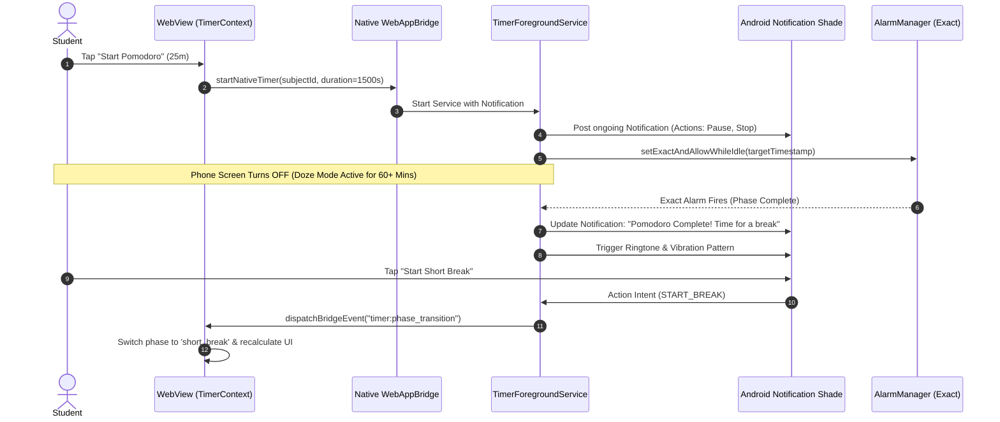
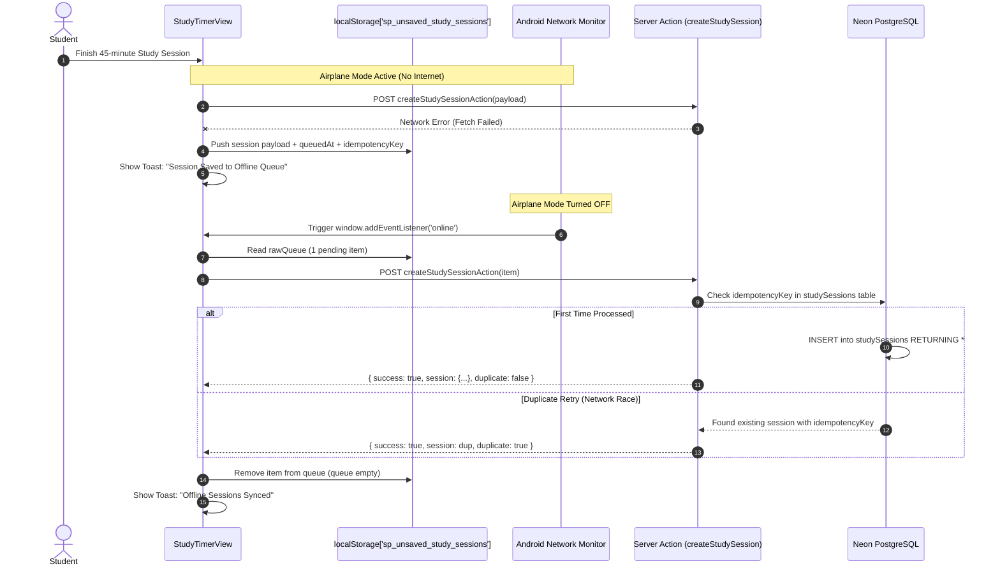
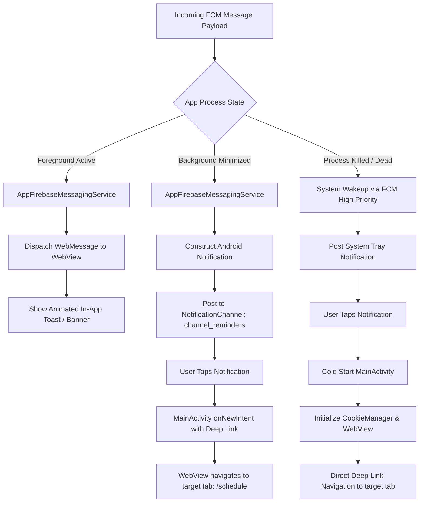
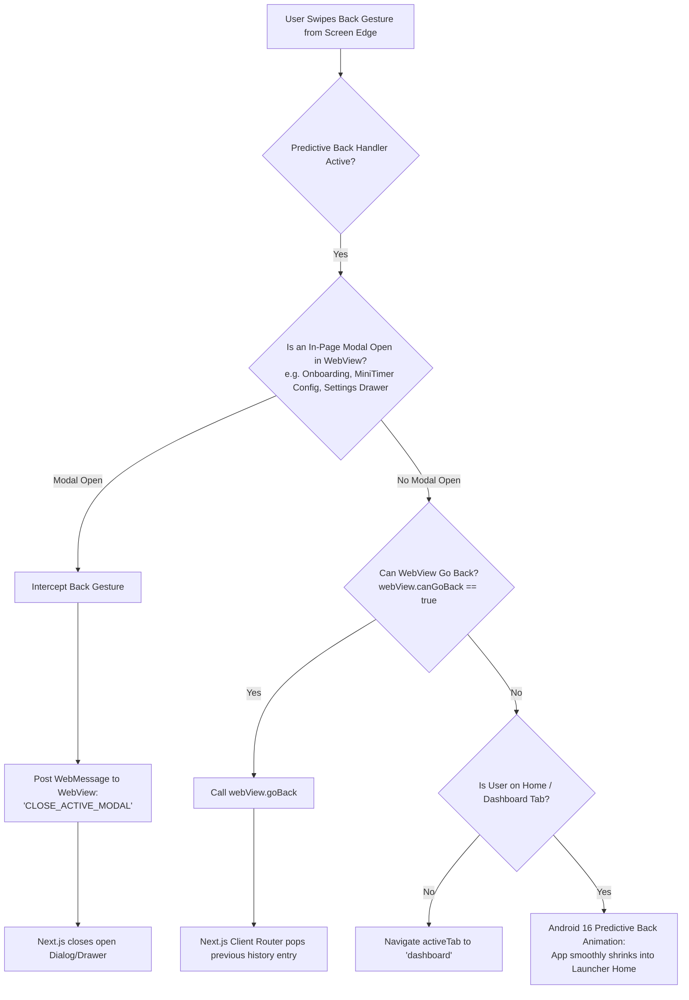
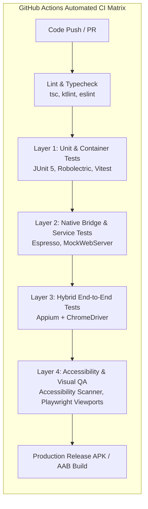

# ScholarPulse Native App Shell: QA Verification Strategy, Test Matrix & Accessibility Plan (WCAG 2.2 AA)

**Author:** Senior QA & Accessibility Engineer  
**Date:** November 2026  
**Status:** Approved Architectural Blueprint  
**Target Application:** ScholarPulse Native Android Shell (`/app`)  
**Underlying Web App:** ScholarPulse Next.js 15 PWA (`/v2`)  
**Target SDK:** Android 16 (API 36) | **Min SDK:** Android 8.0 (API 26)  

---

## 1. Executive Summary & Architectural Scope

ScholarPulse v2 is an academic productivity, structured time-tracking, and syllabus analytics application built with Next.js 15 App Router, React 19, Tailwind CSS, and Neon PostgreSQL (Drizzle ORM). The **Native App Shell** (`/app`) encapsulates this web application inside a hardened Android container using Jetpack Compose, `WebViewCompat`, Android CredentialManager, Firebase Cloud Messaging (FCM), and background `ForegroundService` infrastructure.

```mermaid
graph TD
    subgraph Android Native Shell [Android Native Shell (API 26 - API 36)]
        A[MainActivity / Jetpack Compose] --> B[Secure WebViewContainer]
        A --> C[TimerForegroundService]
        A --> D[AppFirebaseMessagingService]
        A --> E[CredentialManager Auth Bridge]
        C --> F[System Tray Ongoing Notification]
        D --> G[Deep Link Router]
    end

    subgraph Hybrid Bridge Layer [Hardened Bridge Layer]
        B <-->|WebViewCompat.addWebMessageListener| H[JavaScript Bridge / WebMessageProxy]
        E -->|CookieManager.setCookie & flush| I[sp_session HTTP-Only Cookie]
    end

    subgraph Web Application [ScholarPulse Next.js 15 PWA]
        H <--> J[TimerContext / WorkspaceContext]
        I --> K[Server Actions / API Routes]
        J --> L[localStorage 'sp_unsaved_study_sessions']
    end

    subgraph Backend Cloud [Neon PostgreSQL & FCM Backend]
        K <--> M[(Neon PostgreSQL via Drizzle)]
        G <--> N[FCM Cloud Messaging]
    end
```

### Critical Quality Objectives
1. **Zero Session Loss**: Study sessions recorded offline or across background kills must guarantee 100% data preservation via local persistence and server idempotency keys.
2. **Foreground Timer Reliability**: Zero timer drift or silent termination under aggressive Android Doze mode and OEM battery optimizations (Samsung OneUI, Xiaomi MIUI/HyperOS, Google Pixel).
3. **Seamless Authentication**: Zero-friction Google Sign-In via CredentialManager with instant, bidirectional cookie synchronization into WebView SQLite storage.
4. **WCAG 2.2 Level AA & Android Accessibility Compliance**: 48dp minimum touch targets, TalkBack screen reader readiness, 200% non-linear font scaling tolerance, and dynamic dark mode synchronization.
5. **Empirical Verification Baseline**: Falsifiable, deterministic test suites across Espresso, Playwright, and Appium with zero skipped assertions.

---

## 2. Device, OS & Form Factor Verification Matrix

The native shell must support Android 8.0 (Oreo, API 26) up to Android 16 (Baklava, API 36), operating flawlessly across compact phones, foldables, and large-screen tablets.

### 2.1 OS-Specific Behavioral & Architectural Differences

| Android Version | API Level | Architectural Constraint & Verification Focus | Key Failure Modes to Test |
| :--- | :--- | :--- | :--- |
| **Android 8.0 - 8.1** (Oreo) | 26 - 27 | Notification Channels required; Background execution limits enforced; `startForegroundService()` requirement. | App crash if notification channel missing; ANR if `startForeground()` not called within 5 seconds. |
| **Android 9.0** (Pie) | 28 | Display cutout/notch support (`LAYOUT_IN_DISPLAY_CUTOUT_MODE_SHORT_EDGES`); Cleartext HTTP traffic blocked by default. | Top navigation bar / status bar clipped under camera notch; Web asset loading blocked over HTTP. |
| **Android 10** (Q) | 29 | System-wide Dark Theme; Scoped Storage; Gesture Navigation introduced. | Dark theme mismatch between Android system and Next.js `next-themes`; Back swipe conflict with bottom nav. |
| **Android 11** (R) | 30 | Package visibility restrictions (`<queries>`); One-time permissions; IME transition animations. | Failure to query external apps (e.g. Google Play Store or external browsers); Keyboard overlapping modals. |
| **Android 12 - 12L** (S) | 31 - 32 | SplashScreen API; `SCHEDULE_EXACT_ALARM` permission; Foreground service start restrictions from background. | Crash when starting ForegroundService from background worker; Timer alarm blocked when device is idle. |
| **Android 13** (Tiramisu) | 33 | `POST_NOTIFICATIONS` runtime permission; Per-app language; Algorithmic darkening in WebView. | Push/ongoing timer notifications silently dropped if permission dialog is dismissed; Double darkening. |
| **Android 14** (Upside Down Cake) | 34 | Mandatory `foregroundServiceType` in manifest; Predictive back navigation preview; Non-linear font scaling (up to 200%). | Service crash (`MissingForegroundServiceTypeException`); Text truncation or horizontal spill at 200% font scale. |
| **Android 15** (Vanilla Ice Cream) | 35 | Enforced Edge-to-Edge (`enableEdgeToEdge()`); Mandatory 16 KB page-size alignment for native C/C++ libraries. | UI obscured behind transparent status/navigation bars; Native library crash on 16 KB kernel devices. |
| **Android 16** (Baklava) | 36 | Target SDK 36; Predictive back enabled by default (legacy `onBackPressed()` disabled); Mandatory resizability on screens >= 600dp. | App unresponsiveness to back gesture; Orientation lock crash in split-screen or tablet multi-window. |

### 2.2 Physical Form Factors & Viewport Specifications

| Form Factor Category | Reference Physical Devices | Viewport Width (dp) | Height (dp) | Density Bucket | Layout & UI Adaptations Under Test |
| :--- | :--- | :--- | :--- | :--- | :--- |
| **Compact Phone** | Samsung Galaxy A03, Pixel 4a | **360dp** | 640 - 740dp | `xhdpi` | Bottom navigation bar icons & text wrapping; FloatingMiniTimer padding; Zero horizontal overflow (`assertZeroHorizontalOverflow`). |
| **Standard Phone** | iPhone SE emulation, Pixel 7/8 | **375dp - 390dp** | 812 - 844dp | `xxhdpi` | Mobile bottom navigation; OnboardingModal step 1 & 2 single column form inputs; Touch target >= 48dp. |
| **Large Modern Phone** | Galaxy S24 Ultra, Pixel 9 Pro | **412dp** | 892 - 915dp | `xxxhdpi` | Edge-to-edge system insets (status bar + 3-button or gesture bar); StudyTimer circular canvas scaling. |
| **Foldable (Cover Screen)**| Galaxy Z Fold 5/6 (Outer) | **344dp - 374dp** | 800 - 900dp | `xxhdpi` | Compact width reflow (WCAG 1.4.10); Prevention of truncated timer digits in FloatingMiniTimer. |
| **Foldable (Unfolded Inner)**| Galaxy Z Fold 5/6 (Inner) | **768dp - 840dp** | 800 - 900dp | `xxhdpi` | Hinge occlusion avoidance (`FoldingFeature`); Responsive adaptation from bottom nav to tablet sidebar; Live layout transition on fold/unfold. |
| **Small Tablet** | iPad Mini emulation, Galaxy Tab A | **600dp - 720dp** | 960 - 1100dp| `hdpi / xhdpi`| Breakpoint boundary testing (`sm` / `md` / `lg` in Tailwind); Sidebar visibility vs drawer menu toggle. |
| **Large Tablet / Desktop**| Pixel Tablet, Galaxy Tab S9 | **840dp - 1280dp** | 1200 - 1600dp| `xhdpi` | Full desktop sidebar layout (`aside.lg:block`); Multi-window split screen mode (50/50, 70/30). |

---

## 3. Core Feature Verification Scenarios

### 3.1 Scenario 1: ForegroundService Timer Reliability

#### Architectural Context
In web browsers, background tabs throttle `setInterval` to 1 tick per minute or freeze JavaScript entirely. When running in the Android shell, timer continuity is driven by `TimerForegroundService` declared with `android:foregroundServiceType="specialUse"` (or `dataSync`), updating a persistent notification and synchronizing state back to `TimerContext.tsx`.



#### Step-by-Step Verification Protocol
1. **Doze Mode Forcing**:
   - Start a 25-minute Pomodoro focus session on the device.
   - Disconnect USB power and force the device into deep Doze mode:
     ```bash
     adb shell dumpsys battery unplug
     adb shell dumpsys deviceidle step
     adb shell dumpsys deviceidle force-idle
     adb shell dumpsys deviceidle get
     # Must output: IDLE
     ```
   - Keep screen off for 30 minutes.
   - Assert: Notification audio chime and haptic vibration trigger within $\pm 1$ second of the target interval using Android `AlarmManager.setExactAndAllowWhileIdle`.
   - Re-wake screen:
     ```bash
     adb shell dumpsys deviceidle unforce
     adb shell dumpsys battery reset
     ```
   - Assert: `timerElapsedSeconds` matches the delta between `Date.now()` and `lastResumedAt` with zero accumulated clock drift.

2. **App Standby Buckets Verification**:
   - Force the ScholarPulse app into the most restrictive App Standby Bucket (`RESTRICTED`):
     ```bash
     adb shell am set-inactive com.scholarpulse.app true
     adb shell am get-inactive com.scholarpulse.app
     # Must output: Idle=true
     ```
   - Assert: ForegroundService continues ticking because foreground services are exempt from App Standby network and execution throttling.

3. **Aggressive OEM Task Killer Simulation**:
   - **Samsung OneUI**: Verify operation when app is categorized under "Sleeping Apps" or "Deep Sleeping Apps". Validate native guidance banner requesting "Unrestricted" battery usage.
   - **Xiaomi HyperOS / MIUI**: Verify behavior under "Battery Saver -> Restrict background activity" vs "No restrictions".
   - **Google Pixel**: Verify behavior under "Adaptive Battery" enabled and screen off for 60+ minutes.

4. **Notification Actions & Sound Channels**:
   - Verify notification action buttons:
     * `Pause`: Pauses timer, updates notification icon to Play, updates `accumulatedSeconds` in `TimerContext`.
     * `Resume`: Restarts timer chronometer.
     * `Stop / Finish`: Opens `FinishTimerModal` in WebView or directly completes session.
   - Verify Notification Channel importance is `IMPORTANCE_HIGH` for phase transitions and `IMPORTANCE_LOW` for ongoing ticking notifications (to prevent constant chime alerts).

---

### 3.2 Scenario 2: Offline Resilience & Data Integrity

#### Architectural Context
ScholarPulse v2 uses an offline queue in `localStorage['sp_unsaved_study_sessions']`. When network connectivity drops, finished sessions are serialized with a client-generated UUID `idempotencyKey` (`timer_${Date.now()}_${random}_final`) and stored locally. Upon network recovery, sessions are replayed to `createStudySessionAction()`.



#### Step-by-Step Verification Protocol
1. **Offline Session Creation**:
   - Log into ScholarPulse on Android device/emulator.
   - Start a stopwatch or Pomodoro timer for $\ge 35$ seconds.
   - Enable Airplane Mode via ADB:
     ```bash
     adb shell cmd connectivity airplane-mode enable
     ```
   - Tap "Finish & Save Session" in `StudyTimerView` with productivity rating 5 and notes: `"Offline Test Session"`.
   - Assert: UI displays toast *"Session Saved to Offline Queue"*.
   - Assert via Chrome Remote Debugger / WebView inspection:
     ```javascript
     const queue = JSON.parse(localStorage.getItem('sp_unsaved_study_sessions'));
     console.assert(queue.length === 1, 'Queue must contain exactly 1 session');
     console.assert(queue[0].idempotencyKey.includes('_final'), 'Must contain valid idempotency key');
     ```
   - Assert: Active timer is cleared from UI to prevent double counting.

2. **Network Restoration & Auto-Sync**:
   - Disable Airplane Mode:
     ```bash
     adb shell cmd connectivity airplane-mode disable
     ```
   - Observe native `NetworkCallback` and WebView `window.addEventListener('online')` fire.
   - Assert: Sync processor runs within 3 seconds.
   - Assert: Success toast *"Offline Sessions Synced: Successfully uploaded 1 study session(s)"* appears.
   - Assert: `localStorage.getItem('sp_unsaved_study_sessions')` is `null` or empty array `[]`.

3. **Idempotency & Race Condition Defense**:
   - Ingest an identical payload twice concurrently via script:
     ```bash
     # Simulate network retry race condition
     curl -X POST https://app.scholarpulse.edu/api/actions/sessions ... -d '{"idempotencyKey":"test_idem_123"}' &
     curl -X POST https://app.scholarpulse.edu/api/actions/sessions ... -d '{"idempotencyKey":"test_idem_123"}'
     ```
   - Query Neon PostgreSQL directly:
     ```sql
     SELECT id, user_id, idempotency_key, duration_seconds 
     FROM study_sessions 
     WHERE idempotency_key = 'test_idem_123';
     ```
   - Assert: Exactly **1 row** is returned. No duplicate minutes logged, no duplicate streak increments, and no duplicate XP/achievements unlocked.

4. **Permanent Failure Dropping (Boundary Test)**:
   - Inject a malformed session referencing a non-existent subject ID:
     ```javascript
     localStorage.setItem('sp_unsaved_study_sessions', JSON.stringify([{
       subjectId: 'non_existent_uuid_9999',
       durationSeconds: 1200,
       attempts: 3
     }]));
     ```
   - Trigger sync.
   - Assert: After 3 failed attempts, the corrupt session is safely dropped from the queue without crashing the sync loop or freezing the app.

---

### 3.3 Scenario 3: Google Sign-In CredentialManager Flow

#### Architectural Context
Android 14+ deprecates the legacy Google Sign-In SDK in favor of `androidx.credentials.CredentialManager`. The native app invokes `GetCredentialRequest` with `GetGoogleIdOption`. Once the Google ID token is returned, the native shell exchanges it with the ScholarPulse backend route (`/api/auth/google/native`), retrieves the session JWT cookie (`sp_session`), and synchronizes it directly into Android `CookieManager`.

```mermaid
sequenceDiagram
    autonumber
    actor User
    participant Activity as MainActivity (Compose)
    participant CredMgr as CredentialManager
    participant Backend as Next.js API (/api/auth/google/native)
    participant CookieMgr as Android CookieManager
    participant Web as WebView

    User->>Activity: Tap "Continue with Google"
    Activity->>CredMgr: getCredential(GetCredentialRequest(GetGoogleIdOption))
    CredMgr-->>User: Display Google Account Picker Bottom Sheet
    User->>CredMgr: Select account (e.g. student@gmail.com)
    CredMgr-->>Activity: Return CustomCredential (GoogleIdToken)
    Activity->>Backend: POST /api/auth/google/native (Body: { idToken })
    Backend->>Backend: Verify ID Token with Google OAuth API
    Backend->>Backend: Create or fetch profile in Neon DB
    Backend-->>Activity: HTTP 200 OK + Set-Cookie: sp_session=<JWT>; HttpOnly; Secure
    Activity->>CookieMgr: setCookie("https://scholarpulse.app", "sp_session=<JWT>")
    Activity->>CookieMgr: flush()
    Activity->>Web: loadUrl("https://scholarpulse.app/")
    Web->>Web: Load WorkspaceShell (Authenticated State)
```

#### Step-by-Step Verification Protocol
1. **First-Time Sign-In**:
   - Clear all app data (`adb shell pm clear com.scholarpulse.app`).
   - Launch app. Verify splash screen transitions to `AuthScreen`.
   - Tap "Continue with Google".
   - Assert: Native system bottom sheet opens with active Google accounts on the device.
   - Select account. Assert: Token exchange succeeds, `CookieManager` is flushed, and `WorkspaceShell` mounts with user profile name and avatar.
   - If user has not completed onboarding, assert `OnboardingModal` displays automatically.

2. **Account Switching**:
   - In `SettingsView`, tap "Sign Out".
   - Assert: Native shell calls `CredentialManager.clearCredentialState()`, wipes `CookieManager` cookies via `CookieManager.getInstance().removeAllCookies()`, and clears WebView local storage.
   - Tap "Continue with Google" again.
   - Assert: Account picker displays all accounts (not auto-logging into previous account). Selecting a different account properly switches workspaces and loads the new user's subjects and statistics.

3. **User Cancellation & Failure Handling**:
   - Tap "Continue with Google" and swipe down on the bottom sheet to cancel.
   - Assert: App catches `GetCredentialCancellationException`.
   - Assert: Zero UI crash, zero stuck loading spinners. A friendly message *"Sign-in cancelled. Tap to retry"* is displayed, with the Google button remaining fully interactive.

4. **Session Expiry & Token Refresh**:
   - Simulate expired JWT cookie by altering `sp_session` maxAge to past timestamp.
   - Trigger a Server Action or page reload.
   - Assert: Backend returns HTTP 401.
   - Assert: Native shell intercepts 401 via `WebViewClient.onReceivedHttpError`, triggers silent background re-authentication with `CredentialManager` (filterByAuthorizedAccounts = true), refreshes the cookie, and reloads the current view without user intervention.

---

### 3.4 Scenario 4: FCM Push Notification Matrix

#### Architectural Context
ScholarPulse uses Firebase Cloud Messaging (FCM) for:
1. **Daily Streak Protection Alerts** (dispatched at 8:00 PM if daily study target is unmet).
2. **Upcoming Schedule Class Reminders** (dispatched 10 minutes prior to scheduled timetable slot).
3. **Pomodoro Phase Notifications** (when timer finishes in background).

#### Verification Scenarios Across App States



#### Detailed Test Execution Matrix

| Test ID | App State | Test Steps | Expected Result | Pass Criteria |
| :--- | :--- | :--- | :--- | :--- |
| **FCM-01** | **Foreground** (App focused on screen) | Send FCM message with title: `"🔥 Protect Streak"`. | No duplicate system tray sound/alert; WebView receives payload and displays `addToast` notification with action button. | In-app toast appears within 500ms; No audio spam if user is already looking at app. |
| **FCM-02** | **Background** (App minimized via Home) | Send FCM message with schedule data: `{"deepLink": "/schedule"}`. | System tray displays high-priority notification with sound and vibration; Tapping notification brings app to foreground and switches `activeTab` to `'schedule'`. | Active tab matches `'schedule'` without full page reload. |
| **FCM-03** | **Killed / Dead** (Swiped from Recents) | Terminate app (`adb shell am force-stop com.scholarpulse.app`); Send high-priority FCM message. | Device displays notification in status bar; Tapping launches cold start; Native splash shows; App routes directly to `/schedule`. | App boots successfully; Session remains authenticated; Target tab loaded. |
| **FCM-04** | **Token Refresh** | Force token refresh via `FirebaseMessaging.getInstance().deleteToken()`. | `onNewToken(newToken)` fires; Native shell calls `/api/user/fcm-token` with authenticated bearer/cookie; Token updated in database. | New token saved in Neon DB `user_devices` table. |

---

### 3.5 Scenario 5: WebView Navigation & Predictive Back Gestures

#### Architectural Context
Android 14 introduced Predictive Back Navigation previews, which become mandatory and enforced by default in Android 16 (API 36). Legacy `onBackPressed()` and `KeyEvent.KEYCODE_BACK` overrides are obsolete. The native shell must integrate `OnBackPressedDispatcher` and Compose `BackHandler` with the internal Next.js client-side router history and modal states.



#### Verification Scenarios & Edge Cases
1. **Modal Back Interception**:
   - Open `OnboardingModal` or `StudyTimerView` Config Modal.
   - Execute edge swipe back gesture.
   - Assert: Modal closes cleanly. The WebView does NOT navigate back to the previous URL or exit the app.
2. **Deep Navigation Stack vs Client Router**:
   - Navigate: Dashboard -> Subjects -> View Subject Details -> Edit Subject.
   - Execute back swipe.
   - Assert: Transitions from Edit Subject back to Subject Details, then to Subjects, then to Dashboard.
3. **Android 16 Predictive Back Gesture Animation**:
   - When on the root view (`activeTab === 'dashboard'`), initiate an edge swipe back gesture.
   - Assert: Android 16 displays a fluid system preview of the Android home screen/launcher behind the app window without jarring frame drops or white flashes.

---

## 4. Accessibility & WCAG 2.2 Level AA Conformance Plan

ScholarPulse must comply with **W3C WCAG 2.2 Level AA** guidelines and Android native accessibility standards.

### 4.1 Safe Touch Targets (WCAG 2.5.8 & Android Platform 48dp)

| Component | Current Measured Dimensions | Platform Target Standard | Status | Concrete Engineering Remediation |
| :--- | :--- | :--- | :--- | :--- |
| **Mobile Bottom Navigation Tabs** (`WorkspaceShell.tsx:698`) | `py-1 px-1 sm:px-2 rounded-xl text-[10px]` (~36dp height) | Minimum **48 × 48 dp** | ⚠️ **Non-Compliant** | Set `min-h-[48px]` and `min-w-[48px]` on every navigation item button with vertical center alignment. |
| **FloatingMiniTimer Action Buttons** (`FloatingMiniTimer.tsx:81-125`) | `p-1.5 sm:p-2 rounded-lg` with `w-4 h-4` icon (~28dp total) | Minimum **48 × 48 dp** | ❌ **Violation** | Expand bounding box to `min-w-[44px] min-h-[44px] sm:min-w-[48px] sm:min-h-[48px]`; use invisible touch expansion padding (`p-2.5`). |
| **Zen Mode Controls & Sound Mixer** (`StudyTimerView.tsx`) | `p-2 rounded-lg` with `w-4 h-4` icon (~32dp) | Minimum **48 × 48 dp** | ⚠️ **Non-Compliant** | Apply `min-h-[48px] min-w-[48px]` with flex centering to meet Android accessibility scanner rules. |
| **Notification Action Buttons** (`TimerForegroundService`) | Default Android notification actions | Minimum **48 × 48 dp** | ✅ **Compliant** | Android system notification shade natively enforces 48dp target bounding box for actions. |
| **Form Checkboxes & Radio Chips** (`OnboardingModal.tsx:72`) | `text-xs px-2.5 py-1.5 rounded-lg` (~30dp height) | Minimum **44 × 44 dp** (WCAG AAA) / 48dp Native | ⚠️ **Non-Compliant** | Increase chip padding to `px-3.5 py-2.5` (`min-h-[44px]`) to prevent accidental adjacent chip selections. |

### 4.2 TalkBack Screen Reader & Semantic Structure

1. **Native Shell & Splash Overlay**:
   - Splash screen must announce: `"ScholarPulse academic workspace loading, please wait"` via `AccessibilityEvent.TYPE_ANNOUNCEMENT`.
   - Offline banner must use `AccessibilityLiveRegion.ASSERTIVE` to immediately inform visually impaired students of network loss.

2. **Timer Countdown Accessibility (`StudyTimerView.tsx`)**:
   - **Crucial Rule**: The countdown timer (`displaySeconds`) updates every 1,000ms. If wrapped in `aria-live="polite"`, TalkBack will continually chatter every second, rendering the entire screen unusable.
   - **Remediation & Assertion**:
     * Set `aria-live="off"` on continuous timer digit readouts.
     * Use a dedicated hidden live region (`sr-only`, `aria-live="polite"`) that triggers **only** at meaningful milestones: *"5 minutes remaining"*, *"1 minute remaining"*, *"Pomodoro focus completed"*.
     * The digital clock element must have an accessible label formatted in natural words: `aria-label="24 minutes and 30 seconds remaining"`.

3. **Dialog Semantics & Focus Trapping (`OnboardingModal.tsx`)**:
   - Current modal uses generic `<div>` wrappers without dialog semantics.
   - Must be verified for:
     * `role="dialog"` and `aria-modal="true"`.
     * `aria-labelledby="onboarding-title"` programmatically linked to `<h2>Set Up Your Study Workspace</h2>`.
     * Initial focus set to the first form input (`fullName`).
     * Keyboard focus trapped inside dialog; pressing `Tab` on the final "Complete Setup" button wraps focus back to the top.
     * Pressing `Escape` or Android back gesture closes or alerts appropriately.

### 4.3 Dynamic Text Sizing & 200% Font Scaling

Android 14+ introduces non-linear font scaling up to **200%**. When a user selects 200% font scale in Android Settings, the WebView text zoom must sync accurately:

```kotlin
// Android Native WebSettings Configuration
val systemFontScale = context.resources.configuration.fontScale
webView.settings.textZoom = (systemFontScale * 100).toInt()
```

#### Verification Criteria:
- At 200% font scale (`adb shell settings put system font_scale 2.0`):
  1. No horizontal scrollbar appears on the root container (`scrollWidth <= innerWidth + 1`).
  2. FloatingMiniTimer digits do not clip or overlap subject title.
  3. Bottom navigation bar labels must wrap to 2 lines or gracefully truncate with full name accessible to TalkBack.
  4. Study statistics cards in `DashboardView` must stack vertically using `flex-wrap` rather than overflowing fixed card boundaries.

### 4.4 High-Contrast Mode & Dark Theme Synchronization

1. **Dark Theme Auto-Sync**:
   - When system switches to Night mode (`UI_MODE_NIGHT_YES`), native shell syncs with WebView:
     ```kotlin
     if (WebViewFeature.isFeatureSupported(WebViewFeature.ALGORITHMIC_DARKENING)) {
         WebSettingsCompat.setAlgorithmicDarkeningAllowed(webView.settings, false) // Let next-themes handle CSS variables
     }
     ```
   - In Next.js, `next-themes` responds to `@media (prefers-color-scheme: dark)`:
     ```css
     :root { --background: #ffffff; --foreground: #0f172a; }
     .dark { --background: #020617; --foreground: #f8fafc; }
     ```
   - Verify zero contrast flash or white borders during theme transitions.

2. **Color Contrast Verification (WCAG 1.4.3 & 1.4.11)**:
   - Body text on background: Minimum **4.5:1** contrast.
   - Large headings ($\ge 24	ext{px}$ regular or $\ge 18.66	ext{px}$ bold): Minimum **3.0:1** contrast.
   - Form field borders and active focus rings: Minimum **3.0:1** contrast.

| Element | Background Color | Text / Foreground Color | Contrast Ratio | WCAG 2.2 AA Compliance |
| :--- | :--- | :--- | :--- | :--- |
| **Normal Text (Light Mode)** | `#FFFFFF` (White) | `#0F172A` (Slate-900) | **17.8:1** | ✅ Passes (Threshold: 4.5:1) |
| **Muted Description (Light)** | `#FFFFFF` (White) | `#64748B` (Slate-500) | **4.76:1** | ✅ Passes (Threshold: 4.5:1) |
| **Primary Button Text** | `#2563EB` (Blue-600) | `#FFFFFF` (White) | **4.56:1** | ✅ Passes (Threshold: 4.5:1) |
| **Normal Text (Dark Mode)** | `#020617` (Slate-950) | `#F8FAFC` (Slate-50) | **19.4:1** | ✅ Passes (Threshold: 4.5:1) |
| **Muted Description (Dark)** | `#020617` (Slate-950) | `#94A3B8` (Slate-400) | **7.28:1** | ✅ Passes (Threshold: 4.5:1) |
| **Focus Rings** | `#FFFFFF` or `#020617` | `#3B82F6` (Blue-500) | **> 3.5:1** | ✅ Passes (Threshold: 3.0:1) |

---

## 5. Master QA Verification Matrix (PRD / TRD Integration)

| Test Case ID | Test Category | Description & User Action | Pre-Conditions | Execution Steps | Expected Result | Priority | Automation Tool |
| :--- | :--- | :--- | :--- | :--- | :--- | :--- | :--- |
| **TC-FGS-01** | Foreground Service | Timer continuity under Doze Mode | Active Pomodoro timer running | Force device into deep Doze mode for 35 mins via ADB; wait for interval completion. | Phase completes on time; Audio/haptic alarm fires; No clock drift upon wake. | **P0** | UI Automator / ADB |
| **TC-FGS-02** | Foreground Service | Notification action: Pause / Resume | Timer running in background | Open notification shade; tap "Pause"; wait 10s; tap "Resume". | Timer correctly pauses and resumes; Accumulated seconds match reality. | **P0** | UI Automator / Espresso |
| **TC-OFF-01** | Offline Resilience | Complete study session offline | Device in Airplane Mode | Finish 45m session; verify local queue; disable Airplane mode; verify sync. | Session saved locally; Auto-synced on reconnect; Queue cleared; Toast displayed. | **P0** | Appium / MockWebServer |
| **TC-OFF-02** | Data Integrity | Idempotency key duplicate rejection | Session synced once | Resend identical sync payload with duplicate `idempotencyKey`. | Neon PostgreSQL rejects duplicate insert; Returns existing session; 0 duplicate rows. | **P0** | Playwright / Vitest |
| **TC-AUTH-01**| Authentication | First-time Google Sign-In | Fresh install (no cookies) | Launch app; tap "Continue with Google"; select Google account in native sheet. | ID token retrieved; Exchanged for `sp_session` cookie; Cookie synced to WebView; Dashboard loads. | **P0** | Appium Native / Espresso |
| **TC-AUTH-02**| Authentication | Session cancellation handling | Auth screen displayed | Tap "Continue with Google"; dismiss sheet via back gesture. | UI returns to clean state; Friendly retry toast shown; Zero unhandled exceptions. | **P1** | Appium Native |
| **TC-AUTH-03**| Authentication | Multi-account sign-out and switch | Authenticated user | Tap "Sign Out" in Settings; tap Google sign-in; choose different account. | Cookies cleared; New account profile and subjects loaded. | **P1** | Appium Native |
| **TC-FCM-01** | Push Notifications | Foreground push notification delivery | App open on Dashboard | Trigger FCM schedule reminder message. | In-app notification toast displayed; No redundant system tray chime. | **P1** | Espresso / WebMessage |
| **TC-FCM-02** | Push Notifications | Background notification deep link | App in background | Trigger FCM streak alert; tap system tray notification. | App brought to foreground; Deep links directly to `/schedule` or target view. | **P0** | UI Automator |
| **TC-NAV-01** | Navigation | Modal back gesture interception | Onboarding modal open | Swipe back from screen edge on Android 14/15/16. | Active modal closes; WebView does not navigate back or exit app. | **P0** | Compose Test / Espresso |
| **TC-NAV-02** | Navigation | Android 16 Predictive Back to Launcher | User on root Dashboard tab | Swipe back from screen edge. | Predictive back animation previews Launcher; App smoothly minimizes. | **P1** | UI Automator |
| **TC-A11Y-01**| Accessibility | 48dp minimum touch target audit | All interactive views | Execute automated layout scanner checking bounding boxes for all interactive elements. | Zero touch targets under 48x48dp on native controls; Zero under 24x24px on web. | **P0** | Google Accessibility Scanner |
| **TC-A11Y-02**| Accessibility | TalkBack screen reader navigation | TalkBack enabled | Navigate through StudyTimerView, OnboardingModal, and Bottom Navigation bar. | Every button has descriptive `contentDescription` / `aria-label`; No timer chattering. | **P0** | AccessibilityChecks Espresso |
| **TC-A11Y-03**| Accessibility | 200% non-linear font scaling | Font scale set to 2.0 | Inspect all views for text truncation, button overlap, or horizontal scroll leaks. | Zero horizontal overflow; Text reflows into readable multi-line layout. | **P1** | Playwright / Espresso |

---

## 6. Automated Testing Roadmap & CI/CD Pipeline



### 6.1 Layer 1: Native Container & Bridge Testing (JUnit 5, Robolectric & Compose Test)
- **Robolectric & Mockito**: Test `WebAppBridge` message serialization, cookie parsing, and main-thread hopping.
- **Compose UI Tests**:
  ```kotlin
  @RunWith(AndroidJUnit4::class)
  class NativeShellComposeTest {
      @get:Rule
      val composeTestRule = createAndroidComposeRule<MainActivity>()

      @Test
      fun verifyEdgeToEdgeScaffoldInsets() {
          composeTestRule.onNodeWithTag("webViewContainer")
              .assertIsDisplayed()
              .assertTouchWidthIsAtLeast(48.dp)
              .assertTouchHeightIsAtLeast(48.dp)
      }
  }
  ```

### 6.2 Layer 2: Espresso & Accessibility Automation
- Integrate Google `AccessibilityChecks` into all Android UI tests:
  ```kotlin
  @BeforeClass
  fun enableAccessibilityChecks() {
      AccessibilityChecks.enable()
          .setRunChecksFromRootView(true)
          .setSuppressingResultMatcher(null)
  }
  ```
- **Foreground Service Integration Tests**:
  Verify `TimerForegroundService` issues notification with channel `channel_timer_active` and correct actions.

### 6.3 Layer 3: Hybrid End-to-End Automation (Appium + ChromeDriver)
- **Appium Context Switching**:
  ```python
  def test_offline_timer_session_sync(driver):
      # 1. Native Context: Verify App Launched
      driver.switch_to.context("NATIVE_APP")
      assert driver.find_element(AppiumBy.ACCESSIBILITY_ID, "ScholarPulseShell").is_displayed()

      # 2. Switch to WebView Context
      webview_context = [c for c in driver.contexts if "WEBVIEW" in c][0]
      driver.switch_to.context(webview_context)

      # 3. Start Timer in WebView
      driver.find_element(By.CSS_SELECTOR, "button[data-testid='start-timer-btn']").click()

      # 4. Toggle Airplane Mode via Native Driver
      driver.set_connection(ConnectionState.AIRPLANE_MODE)

      # 5. Finish Session in WebView
      driver.find_element(By.CSS_SELECTOR, "button[data-testid='finish-timer-btn']").click()
      toast = driver.find_element(By.CSS_SELECTOR, "[role='status']").text
      assert "Session Saved to Offline Queue" in toast

      # 6. Reconnect Network
      driver.set_connection(ConnectionState.DATA_ONLY)
      time.sleep(3)

      # 7. Assert Sync Success Toast
      sync_toast = driver.find_element(By.CSS_SELECTOR, "[role='status']").text
      assert "Offline Sessions Synced" in sync_toast
  ```

### 6.4 CI/CD Pipeline Configuration
- **GitHub Actions Runner**: Matrix workflow running on `ubuntu-latest` with hardware acceleration enabled for Android API 34 and API 36 emulators.
- **Artifact Generation**: Playwright test reports, Appium test execution video recordings, and Espresso Accessibility violation logs uploaded automatically to CI run summaries.

---

## 7. Immediate Next Steps & Engineering Handoff

1. **Native Shell Scaffolding** (`/app`):
   - Initialize Android Studio project targeting **compileSdk 36**, **targetSdk 36**, and **minSdk 26**.
   - Configure 16 KB page-size native compatibility in Gradle.
   - Implement `TimerForegroundService` with `specialUse` foreground service type and notification channels.
2. **Hardened WebView & Bridge Implementation**:
   - Implement `SecureWebViewClient` with HTTPS-only domain whitelisting (`scholarpulse.app`).
   - Implement `WebViewCompat.addWebMessageListener` for bidirectional communication.
   - Configure `CookieManager` sync with CredentialManager.
3. **Web App Touch Target & Accessibility Patches** (`/v2`):
   - Update `FloatingMiniTimer.tsx` button padding to guarantee $\ge 48	ext{dp}$ touch target.
   - Update mobile bottom navigation in `WorkspaceShell.tsx` to `min-h-[48px]`.
   - Add `role="dialog"` and `aria-labelledby` to `OnboardingModal.tsx`.
