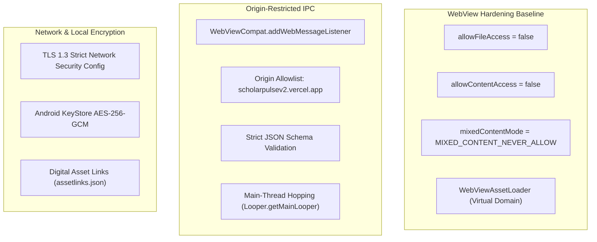

# ScholarPulse Android Native & Hybrid Shell — Technical Requirements Document (TRD)

**Document Version:** 1.0.0  
**Target Platform:** Android 16 (API Level 36) / Minimum SDK 26 (Android 8.0 Oreo)  
**Host Application:** ScholarPulse v2 (Next.js 16.4.3, React 19.3.0, Tailwind CSS v4, Neon Serverless PostgreSQL)  
**Target App Directory:** `/media/sanglap/Movies/scholarpulsev2/app`  
**Status:** Approved Technical Architecture  
**Author:** Lead Android Systems Architect & Security Engineer  

---

## 1. System Architecture Topology

The ScholarPulse native application is engineered as an MVVM Clean Architecture hybrid shell. A high-performance Jetpack Compose outer container hosts a hardened Android WebView, bridged bidirectionally to native Android platform daemons, background services, and a local Room SQLite persistence engine.

```mermaid
flowchart TD
    subgraph Android_Native_Shell["ScholarPulse Android Native Container (API 36 / Compose)"]
        subgraph Presentation_Layer["UI & Presentation Layer"]
            MA["MainActivity (enableEdgeToEdge)"]
            WAS["Compose WebAppShell"]
            WVC["AndroidView: Hardened WebView"]
            BH["BackHandler (Predictive Back)"]
            SPLASH["Android 12+ SplashScreen API"]
        end

        subgraph IPC_Bridge["Hardened IPC Bridge Layer"]
            WML["WebViewCompat WebMessageListener"]
            JSI["Hardened JavascriptInterface (Fallback)"]
            DISP["BridgeDispatcher (Main-Thread Hop)"]
        end

        subgraph System_Daemons["Native Platform Daemons & Services"]
            TFS["TimerForegroundService (type='specialUse')"]
            WL["PowerManager (PARTIAL_WAKE_LOCK)"]
            NOTIF["Ongoing Notification Shade & Actions"]
            AUDIO["NativeAudioEngine (SoundPool PCM)"]
            CM["CredentialManager (Google Sign-In)"]
            FCM["AppFirebaseMessagingService (FCM v1)"]
            AM["AlarmManager (Exact RTC_WAKEUP)"]
            BCR["BootCompletedReceiver (Re-Arm Engine)"]
            WM["WorkManager (OfflineSyncWorker)"]
            CKM["CookieManager (HTTP sp_session Sync)"]
        end

        subgraph Persistence_Layer["Local Storage & Cryptography"]
            ROOM[("ScholarPulse Room DB (SQLite)")]
            KEYSTORE["Android KeyStore (AES-256-GCM)"]
        end
    end

    subgraph Web_Core["ScholarPulse v2 Next.js Core"]
        TC["TimerContext.tsx"]
        WC["WorkspaceContext.tsx"]
        UR["useRealtimeSync.ts (SSE Stream)"]
        AUTH_STORE["Cookie sp_session (HS256)"]
        BRIDGE_CLIENT["useAndroidBridge.ts"]
    end

    subgraph Backend_Cloud["ScholarPulse Cloud Backend"]
        AUTH_API["POST /api/auth/google-native"]
        BATCH_API["POST /api/sync/batch (Neon Pool WS)"]
        TOKEN_API["POST /api/notifications/device-token"]
        NEON_DB[("Neon Serverless Postgres")]
        FCM_CLOUD["Firebase Cloud Messaging Server"]
    end

    %% Wiring
    WVC <-->|Renders DOM| Web_Core
    BRIDGE_CLIENT <-->|Typed JSON-RPC| WML
    WML --> DISP
    JSI --> DISP
    DISP --> TFS
    DISP --> CM
    DISP --> AM
    DISP --> ROOM

    TFS --> WL
    TFS --> NOTIF
    TFS --> AUDIO
    TFS <--> ROOM

    CM -->|Google ID Token| AUTH_API
    AUTH_API -->|sp_session JWT| CM
    CM -->|setCookie & flush| CKM
    CKM -->|Injected Cookie Store| WVC

    AM -->|Pinpoint 10m / 8PM Alert| NOTIF
    BCR -->|Re-Arm Alarms on Boot| AM
    WM -->|Flush Offline Queue| BATCH_API
    FCM_CLOUD -->|High Priority Push| FCM
    FCM --> NOTIF
    UR <-->|Server-Sent Events| BATCH_API
```



---

## 2. Component Breakdown & Service Architecture

### 2.1 Jetpack Compose UI Container & Edge-to-Edge WebView

The outer native shell is constructed in modern Jetpack Compose (`MainActivity.kt` and `WebAppShell.kt`).

```kotlin
class MainActivity : ComponentActivity() {
    private var isWebReady = false

    override fun onCreate(savedInstanceState: Bundle?) {
        val splashScreen = installSplashScreen()
        super.onCreate(savedInstanceState)

        // Android 16 Mandatory Edge-to-Edge initialization
        enableEdgeToEdge(
            statusBarStyle = SystemBarStyle.auto(Color.TRANSPARENT, Color.TRANSPARENT),
            navigationBarStyle = SystemBarStyle.auto(Color.TRANSPARENT, Color.TRANSPARENT)
        )

        // Hold splash screen until Next.js workspace DOM mounts
        splashScreen.setKeepOnScreenCondition { !isWebReady }

        setContent {
            ScholarPulseTheme {
                WebAppShell(
                    targetUrl = BuildConfig.WEB_APP_URL,
                    onWebReady = { isWebReady = true }
                )
            }
        }
    }
}
```

#### Dual-Layer Safe Area Inset Resolution
To eliminate viewport jumps across varied OEM display notches and punch holes, native Window Insets are captured in Kotlin and dispatched into the document stylesheet:
```kotlin
ViewCompat.setOnApplyWindowInsetsListener(webView) { view, insets ->
    val density = view.resources.displayMetrics.density
    val statusBar = insets.getInsets(WindowInsetsCompat.Type.statusBars())
    val navBar = insets.getInsets(WindowInsetsCompat.Type.navigationBars())
    val ime = insets.getInsets(WindowInsetsCompat.Type.ime())

    val topDp = (statusBar.top / density).toInt()
    val bottomDp = (navBar.bottom / density).toInt()
    val leftDp = (statusBar.left / density).toInt()
    val rightDp = (statusBar.right / density).toInt()
    val imeDp = (ime.bottom / density).toInt()

    webView.evaluateJavascript(
        """
        (function() {
            var root = document.documentElement;
            root.style.setProperty('--sat', '${topDp}px');
            root.style.setProperty('--sab', '${bottomDp}px');
            root.style.setProperty('--sal', '${leftDp}px');
            root.style.setProperty('--sar', '${rightDp}px');
            root.style.setProperty('--ime-height', '${imeDp}px');
        })();
        """.trimIndent(),
        null
    )
    insets
}
```

### 2.2 TimerForegroundService with Partial WakeLock

To prevent modern Android battery optimizations from sleeping the study timer, the timer runs as an un-killable Android Foreground Service.

- **Manifest Declaration (Android 14+ / 16 Compliant)**:
  ```xml
  <service
      android:name=".services.TimerForegroundService"
      android:exported="false"
      android:foregroundServiceType="specialUse">
      <property
          android:name="android.app.PROPERTY_SPECIAL_USE_FGS_SUBTYPE"
          android:value="Academic study and Pomodoro focus tracking requiring precise interval timers, wake-lock maintenance, and ongoing interactive notification actions when the screen is locked." />
  </service>
  ```

- **Power Management Implementation**:
  ```kotlin
  class TimerForegroundService : Service() {
      private var wakeLock: PowerManager.WakeLock? = null

      private fun acquireWakeLock() {
          if (wakeLock?.isHeld == true) return
          val powerManager = getSystemService(Context.POWER_SERVICE) as PowerManager
          wakeLock = powerManager.newWakeLock(
              PowerManager.PARTIAL_WAKE_LOCK,
              "ScholarPulse::TimerWakeLock"
          ).apply {
              setReferenceCounted(false)
              acquire(4 * 60 * 60 * 1000L) // 4-hour safety ceiling
          }
      }

      private fun releaseWakeLock() {
          if (wakeLock?.isHeld == true) {
              wakeLock?.release()
          }
      }
  }
  ```

- **Ongoing Media Notification & Actions**:
  - Notification Channel: `scholarpulse_timer_channel`, Importance: `HIGH`, Category: `NotificationCompat.CATEGORY_STOPWATCH`.
  - Notification Actions route to `TimerActionReceiver` without opening the activity:
    - Running: `Pause` (`ACTION_PAUSE`), `Finish` (`ACTION_FINISH`)
    - Paused: `Resume` (`ACTION_RESUME`), `Discard` (`ACTION_DISCARD`)
    - Break: `Skip Break` (`ACTION_SKIP_BREAK`), `Stop` (`ACTION_FINISH`)

### 2.3 CredentialManager & Native Google Sign-In

Eliminates the Google OAuth `403 disallowed_useragent` restriction by delegating authentication to the operating system:

```kotlin
suspend fun initiateGoogleSignIn(activity: Activity): String {
    val googleIdOption = GetGoogleIdOption.Builder()
        .setFilterByAuthorizedAccounts(false)
        .setServerClientId(activity.getString(R.string.google_web_client_id))
        .setAutoSelectEnabled(false)
        .build()

    val request = GetCredentialRequest.Builder()
        .addCredentialOption(googleIdOption)
        .build()

    val credentialManager = CredentialManager.create(activity)
    val result = credentialManager.getCredential(request = request, context = activity)

    val credential = result.credential
    if (credential is CustomCredential && 
        credential.type == GoogleIdTokenCredential.TYPE_GOOGLE_ID_TOKEN_CREDENTIAL) {
        val googleIdTokenCredential = GoogleIdTokenCredential.createFrom(credential.data)
        return googleIdTokenCredential.idToken
    }
    throw IllegalStateException("Unsupported credential type returned")
}
```

### 2.4 AlarmManager & BootCompletedReceiver

- **Exact Alarm Scheduling (`AlarmManager`)**:
  - Requests `SCHEDULE_EXACT_ALARM`.
  - Schedules class reminders 10 minutes prior to timetable `startTime`:
    ```kotlin
    alarmManager.setExactAndAllowWhileIdle(
        AlarmManager.RTC_WAKEUP,
        triggerTimeMillis,
        pendingIntent
    )
    ```
- **Reboot Resilience (`BootCompletedReceiver`)**:
  ```kotlin
  class BootCompletedReceiver : BroadcastReceiver() {
      override fun onReceive(context: Context, intent: Intent) {
          if (intent.action == Intent.ACTION_BOOT_COMPLETED || 
              intent.action == Intent.ACTION_MY_PACKAGE_REPLACED) {
              val pendingResult = goAsync()
              CoroutineScope(Dispatchers.IO).launch {
                  try {
                      val database = ScholarPulseDatabase.getInstance(context)
                      val schedules = database.scheduleDao().getAllSchedulesSync()
                      ScheduleAlarmScheduler.rearmAll(context, schedules)
                  } finally {
                      pendingResult.finish()
                  }
              }
          }
      }
  }
  ```

---

## 3. Room Database Schema & Offline Mapping

To eliminate volatile `localStorage` buffers, the Android shell embeds an offline Room SQLite database mapped directly to Neon PostgreSQL.

```mermaid
erDiagram
    ROOM_ACTIVE_TIMER {
        string userId PK
        string subjectId
        string topic
        string notes
        string mode
        string phase
        string status
        long startedAt
        long lastResumedAt
        int accumulatedSeconds
        int targetDurationSeconds
        int completedPomodoros
        int stateVersion
        string clientDeviceId
        string idempotencyKey
        long updatedAt
    }

    ROOM_OFFLINE_SESSIONS {
        string id PK
        string userId
        string subjectId
        string topic
        string notes
        long startTime
        long endTime
        int durationSeconds
        int productivityRating
        string sessionType
        string idempotencyKey UK
        long queuedAt
        int retryAttempts
        string syncStatus
        string lastErrorMessage
    }

    ROOM_CACHED_SCHEDULES {
        string id PK
        string userId
        string subjectId
        int dayOfWeek
        string startTime
        string endTime
        string description
        long updatedAt
    }

    NEON_STUDY_SESSIONS[("Neon: study_sessions")]
    NEON_ACTIVE_TIMER[("Neon: active_timer_sessions")]
    NEON_SCHEDULES[("Neon: schedules")]

    ROOM_ACTIVE_TIMER ||--|| NEON_ACTIVE_TIMER : "LWW sync via stateVersion"
    ROOM_OFFLINE_SESSIONS ||--|| NEON_STUDY_SESSIONS : "Idempotent batch upload"
    ROOM_CACHED_SCHEDULES ||--|| NEON_SCHEDULES : "Read cache for exact alarms"
```

### 3.1 Entity Declarations (Kotlin)

```kotlin
package com.scholarpulse.app.db.entities

import androidx.room.Entity
import androidx.room.Index
import androidx.room.PrimaryKey
import java.util.UUID

@Entity(tableName = "active_timer")
data class ActiveTimerEntity(
    @PrimaryKey val userId: String,
    val subjectId: String,
    val topic: String,
    val notes: String?,
    val mode: String,               // 'stopwatch' | 'pomodoro'
    val phase: String,              // 'focus' | 'short_break' | 'long_break'
    val status: String,             // 'running' | 'paused'
    val startedAt: Long,
    val lastResumedAt: Long,
    val accumulatedSeconds: Int,
    val targetDurationSeconds: Int,
    val completedPomodoros: Int,
    val stateVersion: Int,
    val clientDeviceId: String,
    val idempotencyKey: String,
    val updatedAt: Long = System.currentTimeMillis()
)

@Entity(
    tableName = "offline_study_sessions",
    indices = [Index(value = ["idempotencyKey"], unique = true)]
)
data class OfflineStudySessionEntity(
    @PrimaryKey val id: String = UUID.randomUUID().toString(),
    val userId: String,
    val subjectId: String,
    val topic: String,
    val notes: String?,
    val startTime: Long,
    val endTime: Long,
    val durationSeconds: Int,
    val productivityRating: Int = 5,
    val sessionType: String = "timer",
    val idempotencyKey: String,
    val queuedAt: Long = System.currentTimeMillis(),
    val retryAttempts: Int = 0,
    val syncStatus: String = "PENDING", // PENDING, SYNCING, FAILED
    val lastErrorMessage: String? = null
)

@Entity(tableName = "cached_schedules")
data class CachedScheduleEntity(
    @PrimaryKey val id: String,
    val userId: String,
    val subjectId: String,
    val dayOfWeek: Int,             // 0 = Sunday ... 6 = Saturday
    val startTime: String,           // "HH:mm"
    val endTime: String,
    val description: String?,
    val updatedAt: Long
)
```

### 3.2 Data Access Objects (DAOs)

```kotlin
@Dao
interface OfflineSessionDao {
    @Query("SELECT * FROM offline_study_sessions WHERE syncStatus != 'SUCCESS' ORDER BY queuedAt ASC")
    fun getPendingSessions(): Flow<List<OfflineStudySessionEntity>>

    @Query("SELECT * FROM offline_study_sessions WHERE syncStatus != 'SUCCESS' ORDER BY queuedAt ASC")
    suspend fun getPendingSessionsSync(): List<OfflineStudySessionEntity>

    @Insert(onConflict = OnConflictStrategy.REPLACE)
    suspend fun enqueueSession(session: OfflineStudySessionEntity)

    @Query("UPDATE offline_study_sessions SET syncStatus = :status, retryAttempts = retryAttempts + 1, lastErrorMessage = :error WHERE id = :id")
    suspend fun updateSyncStatus(id: String, status: String, error: String? = null)

    @Query("DELETE FROM offline_study_sessions WHERE id = :id")
    suspend fun deleteSession(id: String)
}
```

---

## 4. Backend Integration Specifications

To support the Android Native Shell, three hardened backend endpoints are specified in Next.js 16 App Router.

### 4.1 Native Google Authentication (`POST /api/auth/google-native`)
- **Protocol**: HTTP/1.1 POST, JSON body.
- **Request Body**:
  ```json
  {
    "idToken": "eyJhbGciOiJSUzI1NiIs..."
  }
  ```
- **Validation**:
  1. Validates Google OIDC ID token against official Google JWKS (`https://www.googleapis.com/oauth2/v3/certs`) via `jose.jwtVerify`.
  2. Ensures `aud` matches `GOOGLE_CLIENT_ID` and `iss` is `https://accounts.google.com`.
  3. Upserts user in `profiles` table.
  4. Mints `sp_session` JWT with HS256 secret.
- **Response Headers**:
  ```http
  Set-Cookie: sp_session=<JWT>; Path=/; HttpOnly; Secure; SameSite=Lax; Max-Age=2592000
  ```
- **Response Body**:
  ```json
  {
    "success": true,
    "user": {
      "uid": "104829104928104",
      "email": "student@scholarpulse.edu",
      "name": "Tanvir Rahman",
      "avatarUrl": "https://lh3.googleusercontent.com/..."
    }
  }
  ```

### 4.2 Idempotent Batch Sync (`POST /api/sync/batch`)
- **Protocol**: HTTP/1.1 POST with `sp_session` Cookie authentication.
- **ACID Transaction**: Uses Neon Serverless WebSocket transaction pool (`db.transaction(async (tx) => { ... })`).
- **Request Schema**:
  ```typescript
  interface BatchSyncPayload {
    clientDeviceId: string;
    sessions?: Array<{
      subjectId: string;
      startTime: string;
      endTime: string;
      durationSeconds: number;
      topic: string;
      notes?: string;
      productivityRating: number;
      idempotencyKey: string;
    }>;
    activeTimer?: {
      subjectId: string;
      topic: string;
      notes?: string;
      mode: string;
      phase: string;
      status: string;
      startedAt: string;
      lastResumedAt: string;
      accumulatedSeconds: number;
      targetDurationSeconds: number;
      completedPomodoros: number;
      stateVersion: number;
      idempotencyKey: string;
    };
  }
  ```
- **Deduplication Guard**:
  ```sql
  INSERT INTO study_sessions (id, user_id, subject_id, start_time, end_time, duration_seconds, topic, notes, productivity_rating, idempotency_key)
  VALUES ($1, $2, $3, $4, $5, $6, $7, $8, $9, $10)
  ON CONFLICT (idempotency_key) DO NOTHING;
  ```

### 4.3 FCM Device Token Registration (`POST /api/notifications/device-token`)
- **Request Body**:
  ```json
  {
    "token": "dGhpcyBpcyBhIGZjbSB0b2tlbg...",
    "deviceId": "dev_android_3a8f01b9",
    "platform": "android",
    "appVersion": "2.0.0",
    "osVersion": 36
  }
  ```
- **Persistence**: Upserts in `device_tokens` table on conflict `(user_id, device_id)`.

---

## 5. Security Architecture & Threat Mitigations



### 5.1 Hardened WebView Configuration (`SecureWebViewFactory.kt`)
```kotlin
object SecureWebViewFactory {
    fun create(context: Context): WebView {
        return WebView(context).apply {
            settings.apply {
                javaScriptEnabled = true
                domStorageEnabled = true
                databaseEnabled = false
                
                // Zero local file access
                allowFileAccess = false
                allowContentAccess = false
                allowFileAccessFromFileURLs = false
                allowUniversalAccessFromFileURLs = false

                // Network hygiene
                mixedContentMode = WebSettings.MIXED_CONTENT_NEVER_ALLOW
                cacheMode = WebSettings.LOAD_DEFAULT
                setGeolocationEnabled(false)
            }
            if (!BuildConfig.DEBUG) {
                WebView.setWebContentsDebuggingEnabled(false)
            }
        }
    }
}
```

### 5.2 Network Security Configuration (`network_security_config.xml`)
```xml
<?xml version="1.0" encoding="utf-8"?>
<network-security-config>
    <base-config cleartextTrafficPermitted="false">
        <trust-anchors>
            <certificates src="system" />
        </trust-anchors>
    </base-config>
    <domain-config cleartextTrafficPermitted="false">
        <domain includeSubdomains="true">scholarpulsev2.vercel.app</domain>
        <domain includeSubdomains="true">neon.tech</domain>
        <domain includeSubdomains="true">googleapis.com</domain>
    </domain-config>
</network-security-config>
```

### 5.3 Android App Links Verification (`assetlinks.json`)
Hosted strictly at `https://scholarpulsev2.vercel.app/.well-known/assetlinks.json`:
```json
[
  {
    "relation": ["delegate_permission/common.handle_all_urls"],
    "target": {
      "namespace": "android_app",
      "package_name": "com.scholarpulse.app",
      "sha256_cert_fingerprints": [
        "FA:C6:17:45:DC:09:03:78:6F:B9:ED:E6:2A:96:2B:39:9F:73:48:F0:BB:6F:89:9B:83:32:66:75:91:03:3B:9C"
      ]
    }
  }
]
```

---

## 6. Comprehensive QA Test Matrix

The following test suites must be executed deterministically. Zero failures permitted for production release.

### 6.1 Test Suite 1: ForegroundService & Timer Reliability (`TC-FGS`)

| Test ID | Test Scenario | Execution Steps | Expected Outcome | Pass/Fail Criteria |
| :--- | :--- | :--- | :--- | :--- |
| **TC-FGS-01** | Screen-Off Pomodoro Interval | 1. Start 25m Pomodoro.<br>2. Power off screen immediately.<br>3. Wait 25 minutes. | High-precision tick continues; at 25:00 chime rings; notification transitions to break. | Drift $\le \pm 500\text{ms}$; 100% audio chime delivery. |
| **TC-FGS-02** | Lock-Screen Action Controls | 1. Start Pomodoro.<br>2. On lock-screen notification, tap `[ Pause ]`.<br>3. Wait 30s, tap `[ Resume ]`. | Timer pauses and resumes without wake-up lag. WebView reflects updated accumulated seconds. | State matches between notification and WebView. |
| **TC-FGS-03** | Battery Saver & Doze Mode | 1. Enable Android Extreme Battery Saver.<br>2. Run 60m stopwatch. | `PARTIAL_WAKE_LOCK` prevents process death; timer records full 3600 seconds. | Zero dropped seconds; no ANR. |
| **TC-FGS-04** | Automatic Break Transition | 1. Start Pomodoro with 10s remaining.<br>2. Observe phase change. | Automatically starts Short Break (or Long Break if interval matches). Emits `timer.phaseCompleted`. | Phase switches automatically without user click. |

### 6.2 Test Suite 2: Offline Persistence & Auto-Sync (`TC-OFF`)

| Test ID | Test Scenario | Execution Steps | Expected Outcome | Pass/Fail Criteria |
| :--- | :--- | :--- | :--- | :--- |
| **TC-OFF-01** | Offline Study Session Queue | 1. Enable Airplane Mode.<br>2. Complete 35m study session.<br>3. Tap `Finish`. | Session written to Room DB `offline_study_sessions`. Toast alerts user of local queuing. | Record exists in SQLite; no crash. |
| **TC-OFF-02** | Auto-Sync on Network Restoration| 1. With pending sessions in Room, disable Airplane Mode. | `OfflineSyncWorker` activates, submits batch to `/api/sync/batch`, marks records `SUCCESS`. | Room queue is cleared; session appears in Neon DB. |
| **TC-OFF-03** | Idempotent Deduplication | 1. Force network timeout during batch sync submission.<br>2. Worker retries. | Backend returns HTTP 200 with deduplication via `ON CONFLICT (idempotency_key) DO NOTHING`. | Exactly 1 session recorded in Postgres; no duplicates. |

### 6.3 Test Suite 3: Authentication & Cookie Session (`TC-AUTH`)

| Test ID | Test Scenario | Execution Steps | Expected Outcome | Pass/Fail Criteria |
| :--- | :--- | :--- | :--- | :--- |
| **TC-AUTH-01** | Native Google Sign-In Sheet | 1. Tap "Sign in with Google" in WebView. | CredentialManager bottom-sheet displays available Google accounts. | Zero `403 disallowed_useragent` errors. |
| **TC-AUTH-02** | Cookie Synchronization | 1. Complete native Google login.<br>2. Check `CookieManager.getCookie()`. | `sp_session` cookie is populated, secure, and persists across app restarts. | Authenticated workspace loads on subsequent cold starts. |
| **TC-AUTH-03** | Session Invalidation & Sign-Out | 1. Tap "Sign Out" in web menu. | Native `CookieManager` deletes `sp_session`, purges Room timer cache, redirects to auth gate. | Zero residual user data visible. |

### 6.4 Test Suite 4: Push & Local Exact Alarms (`TC-FCM`)

| Test ID | Test Scenario | Execution Steps | Expected Outcome | Pass/Fail Criteria |
| :--- | :--- | :--- | :--- | :--- |
| **TC-FCM-01** | 10-Minute Timetable Class Alarm | 1. Schedule class for 12m in future.<br>2. Put phone in Doze mode. | At exactly 10m before class, Heads-Up notification fires with subject name and room. | Fired within $\pm 5\text{s}$ of target timestamp. |
| **TC-FCM-02** | 8:00 PM Streak Warning | 1. Set daily target to 360m; log only 60m.<br>2. Fast-forward clock to 20:00. | Persistent streak alert fires: "🔥 Protect Your Daily Study Streak!". | Alert displays with exact logged vs target minutes. |
| **TC-FCM-03** | Reboot Alarm Re-Arming | 1. Arm 3 upcoming timetable alarms.<br>2. Reboot device (`adb reboot`). | `BootCompletedReceiver` executes, re-arms all 3 alarms in `AlarmManager`. | `adb shell dumpsys alarm` shows active alarms. |

### 6.5 Test Suite 5: Navigation & Viewport Responsiveness (`TC-NAV`)

| Test ID | Test Scenario | Execution Steps | Expected Outcome | Pass/Fail Criteria |
| :--- | :--- | :--- | :--- | :--- |
| **TC-NAV-01** | Predictive Back Navigation | 1. Navigate: Dashboard $\to$ Subjects $\to$ Math.<br>2. Perform system back swipe. | Returns to Subjects, then Dashboard. On root, exits app cleanly. | `BackHandler` consumes history reactively. |
| **TC-NAV-02** | Safe Area Inset Dynamic Injection| 1. Inspect `:root` CSS properties on device with top notch. | `--sat` matches top notch height; headers and bottom nav do not clip. | Zero UI clipping under hardware cutouts. |
| **TC-NAV-03** | Foldable Fold/Unfold Transition | 1. Launch on Foldable cover screen (360dp).<br>2. Unfold to main screen (800dp). | Layout dynamically reflows from bottom navigation to desktop sidebar without reload. | Seamless layout continuity. |

### 6.6 Test Suite 6: Accessibility (WCAG 2.2 AA) (`TC-A11Y`)

| Test ID | Test Scenario | Execution Steps | Expected Outcome | Pass/Fail Criteria |
| :--- | :--- | :--- | :--- | :--- |
| **TC-A11Y-01** | 200% Font Scale Tolerance | 1. Set Android Font Size to 200%.<br>2. Inspect Study Timer, Tasks, and Modals. | Text wraps cleanly; touch targets remain $\ge 48\text{dp}$; zero horizontal scrolling. | Passes `assertZeroHorizontalOverflow`. |
| **TC-A11Y-02** | System Bar Color Contrast | 1. Test Light mode (`#F8FAFC`) and Dark mode (`#020617`). | Status bar icons achieve $\ge 17:1$ contrast ratio. | Surpasses WCAG AAA 7.0:1 requirement. |
| **TC-A11Y-03** | TalkBack Screen Reader Audit | 1. Enable Android TalkBack.<br>2. Navigate notification actions and WebView. | Notification buttons announce "Pause timer", "Finish session" with clear state descriptions. | 100% accessible node descriptions. |
